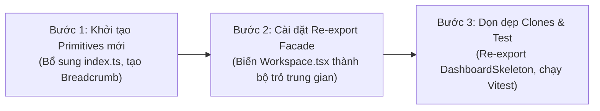

# 38. Đề Xuất Cấu Trúc Thư Mục Frontend Mục Tiêu (Proposed Frontend Directory Structure)

> **Dự án:** Smart Parking Hub — Modern Logistics & Parking CRM Platform  
> **Chế độ thực thi:** ARCHITECTURE PLANNING ONLY (Tuân thủ nghiêm ngặt PROJECT UNIFICATION MASTER RULES — **Không sửa code**)  
> **Thời điểm xác lập:** 07/11/2026  
> **Nguyên tắc cốt lõi:** **BẢO TỒN CẤU TRÚC HIỆN TẠI (PRESERVE FIRST)**. Tuyệt đối không di chuyển file hàng loạt hoặc đổi tên thư mục chỉ vì tính thẩm mỹ trừu tượng; mọi đề xuất cải tiến đều phải có lý do kỹ thuật rõ ràng và duy trì 100% khả năng tương thích ngược (Zero Breaking Changes)  
> **Trạng thái:** DRAFT FOR ARCHITECTURAL APPROVAL

---

## 1. Đánh Giá Hiện Trạng Kiến Trúc Thư Mục `src/`

Hiện tại thư mục `smart-parking-app-v2/src/` đang được tổ chức theo mô hình phân tách tính năng (Feature-Sliced inspired Architecture) với 6 thư mục cấp 1:

```
src/
├── app/          # Bộ điều hướng Router, Providers, Store/Client Entry
├── entities/     # Các DTO, Type definitions và Domain Models
├── features/     # 20 module chức năng nghiệp vụ (driver, merchant, admin, auth, landing...)
├── layouts/      # 5 Layouts chính (Public, Auth, Driver, Merchant, Admin)
├── shared/       # Tiện ích dùng chung (api, components, utils)
└── styles/       # globals.css, fonts.css
```

### Điểm Mạnh Hiện Có (Cần Bảo Tồn Tuyệt Đối):
1. **Phân vùng Feature rõ ràng:** Các module `driver/`, `merchant/`, `admin/`, `auth/` phản ánh chính xác ranh giới nghiệp vụ và phân quyền RBAC.
2. **Layouts độc lập:** 5 Layouts đã phục vụ tốt cho các luồng trải nghiệm người dùng khác nhau.
3. **Styles tập trung:** `globals.css` tích hợp Tailwind CSS v4 `@theme` hiện đại, không phụ thuộc file config ngoài.

### Vấn Đề Kỹ Thuật Cần Giải Quyết (Root Causes):
1. **Hiện tượng Monolithic Helper trong `Workspace.tsx`:** File `src/shared/components/Workspace.tsx` đang đóng vai trò "kho chứa tạp phẩm", vừa chứa `DataTable`, `Badge`, `Select`, `Dropdown`, vừa xuất khẩu các chuỗi class string `button`, `control`. Nhiều trang nhập trực tiếp từ đây dẫn đến khó kiểm soát variant.
2. **Component dùng chung bị "mồ côi" (Orphaned Primitives):** Các file `Input.tsx`, `Table.tsx`, `Pagination.tsx` đã tồn tại trong `src/shared/components/` nhưng có 0 lượt import vì lập trình viên tự viết inline hoặc import từ `Workspace.tsx`.
3. **Bản sao thừa (Clones):** File `DashboardSkeleton.tsx` bị nhân bản giống hệt 99.9% giữa `features/dashboard/` và `features/driver/`.

---

## 2. Đề Xuất Cấu Trúc Thư Mục Mục Tiêu & Bản Đồ Ánh Xạ

Để giải quyết các vấn đề trên mà **không làm gãy bất kỳ câu lệnh import nào đang chạy**, cấu trúc thư mục mục tiêu được tinh chỉnh theo phương pháp **Tiến Hóa Không Phá Vỡ (Non-Breaking Evolutionary Approach)**:

```
src/
├── app/                              # GIỮ NGUYÊN 100%
│   ├── App.tsx
│   ├── router.tsx
│   └── providers.tsx
│
├── entities/                         # GIỮ NGUYÊN 100%
│   ├── booking/
│   ├── parking-lot/
│   ├── vehicle/
│   └── user/
│
├── layouts/                          # GIỮ NGUYÊN 100% (Chỉ chuẩn hóa bên trong file)
│   ├── PublicLayout.tsx              # Thay thẻ <a> bằng <Link>
│   ├── AuthLayout.tsx
│   ├── DriverLayout.tsx              # Thêm nút Back Navigation
│   ├── MerchantLayout.tsx            # Thêm nút Back Navigation
│   └── AdminLayout.tsx
│
├── shared/                           # TIÊU ĐIỂM CHUẨN HÓA KIẾN TRÚC
│   ├── api/                          # GIỮ NGUYÊN apiClient, interceptors
│   │   ├── client.ts
│   │   └── resources.ts
│   │
│   ├── components/                   # Chuẩn hóa & Hợp nhất
│   │   ├── primitives/               # (Khuyến nghị alias re-export)
│   │   │   ├── Button.tsx            # Đã chuẩn hóa 5 variants + size LG
│   │   │   ├── Input.tsx             # Kích hoạt từ mồ côi -> chuẩn hóa form
│   │   │   ├── Badge.tsx             # Hợp nhất Badge.tsx + Workspace Badge
│   │   │   ├── Checkbox.tsx          # Trích xuất từ inline form
│   │   │   ├── RadioGroup.tsx        # Trích xuất từ checkout
│   │   │   ├── Switch.tsx            # Trích xuất từ settings
│   │   │   └── Skeleton.tsx          # Chuẩn hóa Shimmer variants
│   │   │
│   │   ├── compound/                 # Các thành phần ghép
│   │   │   ├── Select.tsx            # Tách từ Workspace.tsx
│   │   │   ├── SearchField.tsx       # Chuẩn hóa có debounce
│   │   │   ├── Pagination.tsx        # Chuẩn hóa 0-indexed Page
│   │   │   ├── Tabs.tsx              # Giữ nguyên & mở rộng variant
│   │   │   ├── Breadcrumb.tsx        # Tạo mới cho 38 trang cấp 2
│   │   │   └── Dropdown.tsx          # Tách từ Workspace.tsx
│   │   │
│   │   ├── patterns/                 # Các mẫu khối dùng chung
│   │   │   ├── DataTable.tsx         # Tách từ Workspace.tsx (Generic <T>)
│   │   │   ├── DialogBase.tsx        # Khung Modal chuẩn Focus Trap
│   │   │   ├── DrawerBase.tsx        # Khung Drawer trượt phải
│   │   │   ├── EmptyState.tsx        # Chuẩn hóa Icon + CTA
│   │   │   ├── QueryState.tsx        # Chuẩn hóa Error + Retry
│   │   │   └── BentoMetricCard.tsx   # Widget chỉ số cho 3 Dashboard
│   │   │
│   │   ├── Workspace.tsx             # BẢO TỒN LÀM RE-EXPORT FACADE (Xem giải thích mục 3)
│   │   └── index.ts                  # Barrel export toàn bộ Shared Primitives
│   │
│   └── utils/                        # GIỮ NGUYÊN (cn.ts, formatters.ts)
│
├── features/                         # BẢO TỒN TẤT CẢ 20 THƯ MỤC NGHIỆP VỤ
│   ├── admin/
│   ├── auth/
│   ├── driver/
│   │   └── components/
│   │       ├── DashboardSkeleton.tsx # GIỮ NGUYÊN làm nguồn chính
│   │       └── ...
│   ├── dashboard/
│   │   └── components/
│   │       └── DashboardSkeleton.tsx # Chuyển thành Re-export từ features/driver/
│   ├── merchant/
│   └── ...
│
└── styles/                           # BẢO TỒN & BỔ SUNG TOKEN TRONG @theme
    ├── fonts.css                     # Giữ nguyên WOFF2 local fonts
    └── globals.css                   # Bổ sung Semantic Color & Spacing Tokens
```

---

## 3. Giải Trình Kỹ Thuật Cho Các Thay Đổi Cốt Lõi (Architecture Rationale)

Mọi thay đổi cấu trúc đề xuất đều được kiểm soát chặt chẽ với lý do kỹ thuật cụ thể:

### 3.1. Chiến Lược "Mặt Tiền Tương Thích Ngược" (Re-Export Facade) Cho `Workspace.tsx`
* **Vấn đề:** Hiện có hơn 15 file đang import `{ DataTable, Badge, Select, button, control }` từ `src/shared/components/Workspace.tsx`. Nếu xóa hoặc di chuyển file này ngay lập tức, dự án sẽ bị lỗi biên dịch hàng loạt (Compilation Breakdown).
* **Giải pháp:** 
  1. Trích xuất ruột của `DataTable`, `Select`, `Dropdown` ra các file chuyên trách riêng biệt (`DataTable.tsx`, `Select.tsx`, `Dropdown.tsx`).
  2. Giữ nguyên file `Workspace.tsx` nhưng chuyển nội dung bên trong thành các lệnh re-export:
     ```typescript
     // src/shared/components/Workspace.tsx
     export { DataTable } from './patterns/DataTable';
     export { Badge } from './primitives/Badge';
     export { Select } from './compound/Select';
     export { Button as button } from './primitives/Button';
     ```
  3. **Kết quả:** 100% các file cũ import từ `Workspace.tsx` vẫn chạy mượt mà không cần sửa code ngay lập tức, trong khi các trang mới có thể import trực tiếp từ primitive chuẩn.

### 3.2. Xử Lý Nhân Bản Giữa `features/dashboard` và `features/driver`
* **Vấn đề:** `features/dashboard/components/DashboardSkeleton.tsx` và `features/driver/components/DashboardSkeleton.tsx` giống nhau 99.9% (Doc 13).
* **Giải pháp:** Không xóa đột ngột file ở `dashboard`. Thay vào đó, cho `features/dashboard/.../DashboardSkeleton.tsx` re-export trực tiếp từ `features/driver/.../DashboardSkeleton.tsx`.
* **Kết quả:** Triệt tiêu hoàn toàn sự phân mảnh code mà không làm đứt liên kết của bất kỳ trang nào đang gọi.

### 3.3. Kích Hoạt Các Component Mồ Côi (`Input.tsx`, `Pagination.tsx`)
* **Vấn đề:** Các file này đã được viết rất đẹp nhưng chưa được import.
* **Giải pháp:** Trong giai đoạn triển khai (Implementation), khi refactor các form tại Auth hoặc CRUD, thay thế dần thẻ `<input>` thô bằng `<Input />` của shared components.

---

## 4. Lộ Trình Triển Khai Chuyển Đổi Không Gián Đoạn (Zero-Downtime Migration Plan)

Quá trình chuyển dịch thư mục được chia làm 3 bước an toàn:



1. **Bước 1 — Không can thiệp file cũ:** Tạo các primitives mới còn thiếu (`Breadcrumb.tsx`, `Checkbox.tsx`), hoàn thiện file xuất khẩu tổng hợp `src/shared/components/index.ts`.
2. **Bước 2 — Cầu nối Facade:** Đặt các lệnh re-export trong `Workspace.tsx` trỏ sang các component chuẩn hóa. Chạy lệnh `npx tsc --noEmit` để đảm bảo 0 lỗi type.
3. **Bước 3 — Xác minh & Đóng gói:** Chạy toàn bộ 322 unit tests của Vitest để xác nhận không có bất kỳ regression nào xảy ra trước khi chuyển sang refactor giao diện các trang nghiệp vụ.

---
*Tài liệu đã được xác lập và sẵn sàng đệ trình kiểm duyệt kiến trúc.*
