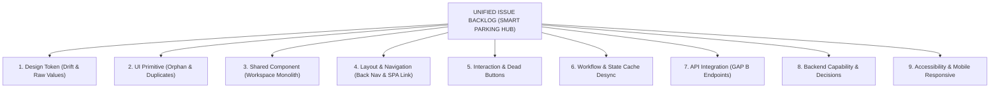

# 39. Danh Mục Vấn Đề Hợp Nhất & Phân Cấp Ưu Tiên (Unified Issue Backlog)

> **Dự án:** Smart Parking Hub — Modern Logistics & Parking CRM Platform  
> **Chế độ thực thi:** PLANNING ONLY (Tuân thủ PROJECT UNIFICATION MASTER RULES — **Không sửa code**)  
> **Thời điểm xác lập:** 07/11/2026  
> **Căn cứ kỹ thuật:** Tổng hợp toàn bộ dữ liệu kiểm toán từ Docs 01 đến 38 (Lỗi token, lỗi component, lỗi tương tác, lỗi điều hướng, lỗi state, và khoảng trống API)  
> **Trạng thái:** DRAFT FOR ARCHITECTURAL APPROVAL

---

## 1. Phân Cấp Mức Độ Ưu Tiên (Priority Classification Definition)

* **P0 — Critical (Chặn chức năng hoặc rủi ro nghiệp vụ nghiêm trọng):** Các vấn đề khiến người dùng không thể hoàn thành luồng công việc cốt lõi (thanh toán, xác thực, mất dữ liệu, hoặc sai lệch số tiền/vé).
* **P1 — High (Ảnh hưởng lớn đến khả năng sử dụng hoặc tính đúng đắn):** Nút bấm không phản hồi (dead buttons), liên kết dẫn đến trang 404, bất đồng bộ cache dữ liệu giữa các màn hình, component bị nhân bản trùng lặp.
* **P2 — Medium (Thiếu tính đồng bộ hoặc trải nghiệm chưa tối ưu):** Thiếu nút quay lại (Back navigation), thiếu đường dẫn phân cấp (Breadcrumbs), component nguyên tử bị mồ côi (orphaned), lệch sắc độ hover vô ý (drift).
* **P3 — Low (Đánh bóng & Cải thiện vi mô):** Tinh chỉnh kích thước chữ vi mô, bổ sung tooltip giải thích, tối ưu viền đệm và hiệu ứng chuyển động mượt mà.

---

## 2. Bảng Gom Nhóm Vấn Đề Toàn Diện Theo 13 Phân Loại Nghiệp Vụ

---

### PHÂN LOẠI 1: DESIGN TOKEN ISSUES (LỆCH MÃ MÀU & GIÁ TRỊ THÔ)

| Mã Issue | Mức Độ | Mô Tả Chi Tiết Vấn Đề | File / Vị Trí Phát Hiện | Nguyên Nhân Gốc Rễ (Root Cause) | Giải Pháp Chuẩn Hóa |
| :--- | :---: | :--- | :--- | :--- | :--- |
| **ISSUE-TOK-01** | **P2** | **Lệch màu hover cam vô ý (`#b85000` vs `#b84e00`):** 14 vị trí trong các component tài xế và bãi đỗ gõ nhầm mã hex lệch 2 đơn vị kênh Green. | `DriverDashboardPage.tsx`, `InlineQuickBookPanel.tsx`... | Lập trình viên gõ inline class `hover:bg-[#b85000]` khi convert Stitch HTML thay vì dùng token. | Đưa toàn bộ về token chuẩn `--color-brand-primary-hover: #b84e00`. |
| **ISSUE-TOK-02** | **P2** | **Raw values trôi nổi số lượng lớn của Stitch Merchant:** Mã xanh đen `#0d1c2e` (207 lần), xanh xám `#455f87` (77 lần), nền xanh `#eff4ff` (97 lần), nền tối `#131b2e` (83 lần). | Toàn bộ 44 files tại `src/features/merchant/*` | Palette màu của giao diện Stitch chưa được đăng ký chính thức vào `@theme` của Tailwind v4. | Đăng ký bộ token Merchant Domain Palette trong `@theme` (`globals.css`). |
| **ISSUE-TOK-03** | **P3** | **Kích thước chữ vi mô tùy tiện:** Xuất hiện 237 vị trí `text-[11px]` và 63 vị trí `text-[10px]`. | Toàn bộ bảng biểu Merchant và nhãn camera ALPR | Thiếu token cỡ chữ vi mô trong thang font của Tailwind v4. | Đăng ký `--text-2xs: 11px` và `--text-3xs: 10px` vào `@theme`. |
| **ISSUE-TOK-04** | **P2** | **Bất nhất kích thước container:** Trang Marketing dùng `1240px` xen kẽ với `1280px` ngay trên cùng một trang `/pricing`. | `PricingHeroSection.tsx`, `PricingCardsSection.tsx` | Thiếu quy chuẩn phân định giữa Marketing Container (1240px) và App Canvas (1280px). | Chuẩn hóa theo Doc 32 (`container-marketing` vs `container-app`). |

---

### PHÂN LOẠI 2: UI PRIMITIVES & SHARED COMPONENT ISSUES

| Mã Issue | Mức Độ | Mô Tả Chi Tiết Vấn Đề | File / Vị Trí Phát Hiện | Nguyên Nhân Gốc Rễ | Giải Pháp Chuẩn Hóa |
| :--- | :---: | :--- | :--- | :--- | :--- |
| **ISSUE-CMP-01** | **P1** | **Component nguyên tử bị mồ côi (Orphaned):** `Input.tsx`, `Table.tsx`, `Pagination.tsx` có **0 lượt import**. | `src/shared/components/Input.tsx`, `Table.tsx`, `Pagination.tsx` | Các màn hình tự dựng thẻ HTML thô hoặc import từ file monolithic `Workspace.tsx`. | Kích hoạt và đấu nối `Input.tsx` vào tất cả các form; tái sử dụng `Pagination.tsx`. |
| **ISSUE-CMP-02** | **P1** | **Xung đột tên Component `Badge`:** Tồn tại song song `Badge.tsx` (variant prop) và `Badge` trong `Workspace.tsx` (regex value prop). | `shared/components/Badge.tsx` `shared/components/Workspace.tsx` | Hai lập trình viên viết độc lập ở 2 giai đoạn khác nhau của dự án. | Hợp nhất thành 1 component `Badge.tsx` duy nhất hỗ trợ cả 2 chế độ (Doc 33). |
| **ISSUE-CMP-03** | **P1** | **Nhân bản component trùng lặp 99.9%:** `DashboardSkeleton.tsx` tồn tại 2 bản giống hệt nhau. | `features/dashboard/components/DashboardSkeleton.tsx` `features/driver/components/DashboardSkeleton.tsx` | Scaffolding thừa chưa dọn dẹp khi tách feature. | Xóa bản sao thừa, dùng kỹ thuật Re-export Facade trỏ về 1 nguồn duy nhất. |
| **ISSUE-CMP-04** | **P1** | **Hiện tượng Monolithic Helper trong `Workspace.tsx`:** Một file ôm đồm DataTable, Badge, Select, Dropdown, control, button. | `src/shared/components/Workspace.tsx` | Codebase kế thừa từ bản prototype trước đây. | Tách nhỏ thành các component độc lập và biến `Workspace.tsx` thành Re-export Facade. |

---

### PHÂN LOẠI 3: INTERACTION & NAVIGATION DEFECTS (LỖI TƯƠNG TÁC & ĐIỀU HƯỚNG)

| Mã Issue | Mức Độ | Mô Tả Chi Tiết Vấn Đề | File / Vị Trí Phát Hiện | Hậu Quả Thực Tế | Giải Pháp Chuẩn Hóa |
| :--- | :---: | :--- | :--- | :--- | :--- |
| **ISSUE-INT-01** | **P1** | **Nút bấm Carousel bị liệt hoàn toàn:** Hai nút Prev/Next đánh giá khách hàng không có thuộc tính `onClick`. | `features/landing/components/HomeTestimonials.tsx` (dòng 50-64) | Người dùng bấm nút nhưng không có bất kỳ phản hồi hay chuyển slide nào xảy ra. | Bổ sung state quản lý chỉ số slide active và handler `onClick` kèm chuyển động mượt. |
| **ISSUE-NAV-01** | **P1** | **Liên kết Navbar dẫn đến trang lỗi 404:** Các link `/company/about`, `/company/contact`, `/company/blog` không tồn tại route. | `features/landing/components/LandingNavbar.tsx` (dòng 76-88) | Người dùng click vào menu bị văng ra trang lỗi 404 Not Found. | Sửa lại đường dẫn trỏ về đúng các route đã có: `/about`, `/contact`, `/careers`. |
| **ISSUE-NAV-02** | **P1** | **Thẻ `<a>` gây tải lại toàn bộ trang (Full Page Reload):** Footer Marketing dùng thẻ `<a>` thay vì `<Link>`. | `features/landing/components/LandingFooter.tsx` (dòng 62-110) | Mất trạng thái SPA, trình duyệt chớp trắng tải lại toàn bộ bundle JavaScript. | Chuyển toàn bộ thẻ `<a>` nội bộ sang component `<Link>` của React Router. |
| **ISSUE-NAV-03** | **P2** | **Neo liên kết chết (`#lien-he`):** Anchor `#lien-he` bị hardcode trên các trang con không có phần tử mang `id="lien-he"`. | `LandingNavbar.tsx` trên các trang `/pricing`, `/solutions` | Click không có tác dụng, URL bị gắn thêm `#lien-he`. | Điều hướng về trang `/contact` khi người dùng đang ở trang con. |
| **ISSUE-NAV-04** | **P2** | **52 / 56 màn hình thiếu nút quay lại (Back Navigation):** Người dùng không có cách nào lùi lại trang trước trên mobile. | Toàn bộ các trang con cấp 2 trở lên của Driver và Merchant Portal | Người dùng bị kẹt trong màn hình con hoặc phải dùng nút Back của trình duyệt. | Bổ sung nút Back Navigation chuẩn trên Page Header kèm fallback route an toàn. |
| **ISSUE-NAV-05** | **P2** | **Thiếu đường dẫn phân cấp (Breadcrumbs):** 38 trang chi tiết không có thanh điều hướng breadcrumb. | Các trang `/merchant/parking-lots/:id/edit`, `/driver/bookings/:id`... | Người dùng mất định vị vị trí phân cấp trong ứng dụng CRM. | Tích hợp component `Breadcrumb.tsx` chuẩn vào Page Header của 38 trang này. |
| **ISSUE-NAV-06** | **P1** | **Ngõ cụt điều hướng khi hủy thanh toán (`/payment/cancel`):** Trang hủy thanh toán không có nút quay lại bãi đỗ. | `features/payment-cancel/pages/PaymentCancelPage.tsx` | Tài xế hủy thanh toán bị kẹt lại màn hình trống, không thể đặt lại chỗ. | Bổ sung 2 nút hành động: "Thử thanh toán lại" và "Quay lại danh sách bãi xe". |

---

### PHÂN LOẠI 4: WORKFLOW & STATE CACHE DESYNC (BẤT ĐỒNG BỘ DỮ LIỆU)

| Mã Issue | Mức Độ | Mô Tả Chi Tiết Vấn Đề | File / Vị Trí Phát Hiện | Hậu Quả Thực Tế | Giải Pháp Chuẩn Hóa |
| :--- | :---: | :--- | :--- | :--- | :--- |
| **ISSUE-STA-01** | **P0** | **Bất đồng bộ dữ liệu sau Mutation (Stale Cache Desync):** **20 trong số 23 `useMutation`** không gọi `queryClient.invalidateQueries()`. | `features/bookings/api/*`, `features/driver/api/*`, `features/merchant/api/*` | Ví dụ: Tài xế hủy vé thành công nhưng Dashboard vẫn hiển thị vé đang hoạt động tới 5 phút; Chủ bãi duyệt xe nhưng danh sách chờ không cập nhật. | Bổ sung `onSuccess: () => { queryClient.invalidateQueries({ queryKey: [...] }) }` cho toàn bộ 20 mutations. |
| **ISSUE-STA-02** | **P1** | **Mất trạng thái giữ chỗ khi reload trang:** Bộ đếm 10 phút giữ chỗ lưu ở React local state thay vì đồng bộ với thời gian hết hạn trên Backend. | `features/bookings/components/BookingHoldingTimer.tsx` | Tài xế F5 lại trang thì đồng hồ đếm lại từ đầu, gây hiểu lầm là vé vẫn còn giữ. | Lấy `expiresAt` từ API Backend và tính toán khoảng cách thời gian thực (Delta time). |

---

### PHÂN LOẠI 5: API INTEGRATION & CONTRACT MISMATCH (HỢP ĐỒNG API)

| Mã Issue | Mức Độ | Mô Tả Chi Tiết Vấn Đề | Endpoint Liên Quan | Nguyên Nhân Gốc Rễ | Giải Pháp Chuẩn Hóa |
| :--- | :---: | :--- | :--- | :--- | :--- |
| **ISSUE-API-01** | **P1** | **Lệch URL API lấy mã OTP quên mật khẩu (Contract Mismatch):** Frontend gọi `/api/v1/auth/recovery-otp`, Backend phục vụ `/api/v1/auth/forgot-password/otp`. | `auth-service` Controller | Thiếu tài liệu đối chiếu contract giữa 2 đội ngũ. | Cập nhật Frontend endpoint khớp 100% với Backend Controller hiện có. |
| **ISSUE-API-02** | **P1** | **Lệch cấu trúc phân trang 0-indexed vs 1-indexed:** Backend trả về `Page<T>` có `number` bắt đầu từ 0, Frontend hiển thị `currentPage` từ 1. | Mọi GET endpoint có phân trang tại `booking-service`, `parking-lot-service` | Quy ước mặc định của Spring Data Page là 0-indexed. | Chuẩn hóa tầng Adapter chuyển đổi: `fePage = bePage + 1`. |
| **ISSUE-API-03** | **P1** | **33 Endpoints Backend đã viết xong nhưng chưa tích hợp vào FE (GAP B):** Chưa kích hoạt tính năng AI mô tả bãi xe (`ai-service`), Barie ALPR check-out (`booking-service`), và Đọc/Đếm thông báo (`notification-service`). | `POST /api/v1/ai/generate-description` `POST /api/v1/merchant/check-out` `PUT /api/v1/notifications/{id}/read` | Frontend chưa xây dựng UI và hooks kết nối. | Xây dựng Service functions và gắn vào UI (Batch 06). |
| **ISSUE-API-04** | **P0** | **Thiếu API Tra cứu số dư ví tài xế (Missing Backend Capability):** Màn hình `/driver/wallet` đang hiển thị dữ liệu tĩnh hoặc suy diễn từ lịch sử giao dịch. | `GET /api/v1/wallets/me` (Đề xuất `PROPOSED-API-01`) | Backend chưa mở Controller quản lý tài khoản ví cho tài xế trong `payment-service`. | Đệ trình Backend Lead phê duyệt và phát triển endpoint. |
| **ISSUE-API-05** | **P1** | **Thiếu cơ chế khóa trùng lặp thanh toán PayOS (Idempotency Risk):** Khi bấm nút thanh toán nhiều lần có thể sinh ra nhiều link PayOS trùng lặp. | `POST /api/v1/payments/create-link` | Chưa truyền Header `Idempotency-Key` hoặc khóa nút submit ở FE. | Bổ sung trạng thái khóa nút `isLoading` và sinh UUID `Idempotency-Key` cho mỗi lượt thanh toán. |

---

### PHÂN LOẠI 6: ACCESSIBILITY & RESPONSIVE (TRỢ NĂNG & THÍCH ỨNG)

| Mã Issue | Mức Độ | Mô Tả Chi Tiết Vấn Đề | Vị Trí Phát Hiện | Hậu Quả Thực Tế | Giải Pháp Chuẩn Hóa |
| :--- | :---: | :--- | :--- | :--- | :--- |
| **ISSUE-A11Y-01**| **P2** | **Nút Icon đơn thiếu nhãn trợ năng (Missing `aria-label`):** Hơn 40 nút icon (đóng modal, menu 3 chấm, đổi view) không có nhãn văn bản. | Các Modal, Bảng điều khiển Merchant | Trình đọc màn hình (Screen Reader) của người khiếm thị chỉ đọc "Button" không có nghĩa. | Bổ sung thuộc tính `aria-label` mô tả hành động cho 100% Icon-only Buttons. |
| **ISSUE-A11Y-02**| **P2** | **Mất viền Focus-Visible khi duyệt bằng phím Tab:** Nhiều nút inline bị gán `outline-none` mà không bù lại `focus-visible:ring-2`. | Form đăng nhập, Bộ lọc tìm kiếm | Người dùng sử dụng bàn phím không biết con trỏ đang ở phần tử nào. | Áp dụng `Button.tsx` chuẩn đã có `focus-visible:ring-2 ring-brand-primary/40`. |
| **ISSUE-RES-01** | **P2** | **Vùng chạm di động dưới 44px (Tap Target Violation):** Nhiều nút thao tác trên mobile chỉ cao 32px (`h-8`). | Thanh tác vụ dưới đáy màn hình của Driver | Bác tài xế tay to hoặc đeo găng tay bấm nhầm hoặc bấm trượt. | Áp dụng chiều cao tối thiểu `h-11` (44px) cho toàn bộ các nút thao tác chính trên Mobile. |
| **ISSUE-RES-02** | **P2** | **Tràn ngang bảng dữ liệu trên điện thoại:** Một số bảng danh sách bãi xe bị tràn màn hình gây xuất hiện thanh cuộn ngang khó chịu. | Màn hình quản lý xe và lượt đỗ trên mobile | Trải nghiệm người dùng bị đứt gãy. | Tích hợp chế độ xem Thẻ (Mobile Card View) tự động khi độ rộng màn hình < 640px. |

---
*Tài liệu đã được xác lập và sẵn sàng đệ trình kiểm duyệt kiến trúc.*
