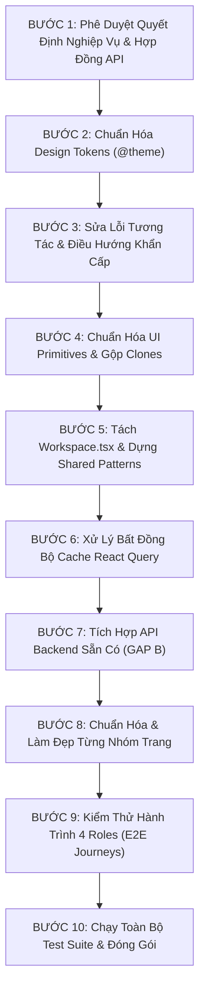

# 40. Lộ Trình Triển Khai & Các Gói Nghiệm Thu (Implementation Roadmap & Batches)

> **Dự án:** Smart Parking Hub — Modern Logistics & Parking CRM Platform  
> **Chế độ thực thi:** PLANNING ONLY (Tuân thủ PROJECT UNIFICATION MASTER RULES — **Không sửa code**)  
> **Thời điểm xác lập:** 07/11/2026  
> **Nguyên tắc phân bổ:** Chia nhỏ công việc thành 8 Batch độc lập, có thể kiểm thử và nghiệm thu từng bước (Independent Verifiable Batches)  
> **Trạng thái:** DRAFT FOR ARCHITECTURAL APPROVAL

---

## 1. Chuỗi Thứ Tự Phụ Thuộc Kỹ Thuật (Strict Dependency Order)

Để đảm bảo không bao giờ phải viết lại hoặc sửa giật lùi (No Rework), toàn bộ quá trình triển khai tuân thủ chuỗi 10 bước phụ thuộc logic:

---

## 2. Danh Mục 8 Gói Triển Khai Chi Tiết (Implementation Batches)

---

### BATCH 01: ZERO-RISK DESIGN TOKENS & GLOBAL STYLES
* **Batch ID:** `BATCH-01`.
* **Mục tiêu (Objective):** Đăng ký toàn bộ Semantic Tokens vào khối `@theme` của Tailwind CSS v4 trong `src/styles/globals.css`, triệt tiêu mã màu lệch `#b85000` và giá trị thô trôi nổi. Hoàn toàn không sửa logic component.
* **Tệp can thiệp (Files):** `src/styles/globals.css`.
* **Màn hình ảnh hưởng (Routes Affected):** Toàn bộ 56 màn hình (thừa hưởng biến CSS, hiển thị đúng màu).
* **Mã Issue giải quyết:** `ISSUE-TOK-01`, `ISSUE-TOK-02`, `ISSUE-TOK-03`, `ISSUE-TOK-04`.
* **Tiền đề kỹ thuật (Dependencies):** Không (Độc lập 100%).
* **Phụ thuộc API (API Dependencies):** Không.
* **Tiêu chí nghiệm thu (Acceptance Criteria):**
  1. File `globals.css` chứa đầy đủ các token `--color-brand-*`, `--color-merchant-*`, `--text-2xs`, `--text-3xs`.
  2. Các alias cũ được giữ nguyên 100%, không gây mất màu ở bất kỳ component nào.
  3. Lệnh `npm run build` chạy thành công không có cảnh báo CSS syntax.
* **Phạm vi hồi quy (Regression Scope):** Cực thấp (Zero-Risk Visual Addition).
* **Độ phức tạp (Complexity):** Thấp (Low — 1 ngày làm việc).

---

### BATCH 02: CRITICAL NAVIGATION & INTERACTIVE LINK FIXES
* **Batch ID:** `BATCH-02`.
* **Mục tiêu:** Sửa các nút carousel bị liệt, xóa bỏ hoàn toàn các liên kết 404 trên Navbar, chuyển thẻ `<a>` ở Footer thành `<Link>` của React Router, và bổ sung lối thoát điều hướng cho trang hủy thanh toán.
* **Tệp can thiệp:**
  * `src/features/landing/components/HomeTestimonials.tsx`
  * `src/features/landing/components/LandingNavbar.tsx`
  * `src/features/landing/components/LandingFooter.tsx`
  * `src/features/payment-cancel/pages/PaymentCancelPage.tsx`
* **Màn hình ảnh hưởng:** SCR-01 (`/`), SCR-02 (`/solutions`), SCR-03 (`/pricing`), SCR-55 (`/payment/cancel`).
* **Mã Issue giải quyết:** `ISSUE-INT-01`, `ISSUE-NAV-01`, `ISSUE-NAV-02`, `ISSUE-NAV-03`, `ISSUE-NAV-06`.
* **Tiền đề kỹ thuật:** `BATCH-01`.
* **Phụ thuộc API:** Không.
* **Tiêu chí nghiệm thu:**
  1. Nút Prev / Next tại Testimonials bấm chuyển slide mượt mà, có trạng thái disabled khi ở đầu/cuối slide.
  2. Bấm vào các menu trên Navbar không còn bị văng ra trang lỗi 404.
  3. Bấm liên kết ở Footer chuyển trang tức thì mà trình duyệt không bị chớp trắng reload toàn trang.
  4. Trang `/payment/cancel` có nút rõ ràng để quay lại bãi xe hoặc thanh toán lại.
* **Phạm vi hồi quy:** Khu vực Marketing Layout và Thanh toán.
* **Độ phức tạp:** Thấp (Low — 1 ngày làm việc).

---

### BATCH 03: CORE UI PRIMITIVES & ORPHAN CLEAN-UP
* **Batch ID:** `BATCH-03`.
* **Mục tiêu:** Hoàn thiện và kích hoạt các component nguyên tử dùng chung; hợp nhất `Badge.tsx` với `Workspace.Badge`; xóa bản sao thừa `DashboardSkeleton.tsx`; bổ sung `Checkbox`, `RadioGroup`, `Switch`.
* **Tệp can thiệp:**
  * `src/shared/components/Button.tsx` (bổ sung size LG 44px, focus ring cam)
  * `src/shared/components/Input.tsx` (bổ sung search, password toggle, error a11y)
  * `src/shared/components/Badge.tsx` (hợp nhất 2 file thành 1 API)
  * `src/shared/components/Skeleton.tsx` (chuẩn hóa variants text, circle, rect)
  * `src/shared/components/Checkbox.tsx` (tạo mới)
  * `src/shared/components/RadioGroup.tsx` (tạo mới)
  * `src/shared/components/Switch.tsx` (tạo mới)
  * `src/features/dashboard/components/DashboardSkeleton.tsx` (re-export từ driver)
* **Màn hình ảnh hưởng:** 56 màn hình.
* **Mã Issue giải quyết:** `ISSUE-CMP-01`, `ISSUE-CMP-02`, `ISSUE-CMP-03`, `ISSUE-A11Y-01`, `ISSUE-A11Y-02`, `ISSUE-RES-01`.
* **Tiền đề kỹ thuật:** `BATCH-01`.
* **Tiêu chí nghiệm thu:**
  1. Component `Badge.tsx` hỗ trợ cả 2 cách gọi: `<Badge variant="success">` và `<Badge value="PAID">` mà không bị gãy code.
  2. Toàn bộ 43 test suites (322 unit tests) tiếp tục đạt **PASS 100%**.
  3. Lệnh `npx tsc --noEmit` đạt 0 lỗi.
* **Phạm vi hồi quy:** Toàn hệ thống (kiểm tra chặt chẽ TypeScript strict).
* **Độ phức tạp:** Trung bình (Medium — 2-3 ngày làm việc).

---

### BATCH 04: SHARED COMPOUND COMPONENTS & WORKSPACE DECOUPLING
* **Batch ID:** `BATCH-04`.
* **Mục tiêu:** Tách file monolithic `Workspace.tsx` thành các component độc lập (`DataTable.tsx`, `Select.tsx`, `Dropdown.tsx`) và biến `Workspace.tsx` thành Facade Re-export; tạo mới `Breadcrumb.tsx` và `DialogBase.tsx`.
* **Tệp can thiệp:**
  * `src/shared/components/Workspace.tsx` (chuyển thành Facade)
  * `src/shared/components/patterns/DataTable.tsx` (Generic `<T>`)
  * `src/shared/components/compound/Select.tsx`
  * `src/shared/components/compound/Dropdown.tsx`
  * `src/shared/components/compound/Breadcrumb.tsx` (tạo mới)
  * `src/shared/components/patterns/DialogBase.tsx` (tạo mới)
  * `src/shared/components/index.ts` (barrel export)
* **Màn hình ảnh hưởng:** 48 màn hình quản trị và danh sách.
* **Mã Issue giải quyết:** `ISSUE-CMP-04`, `ISSUE-NAV-04`, `ISSUE-NAV-05`, `ISSUE-RES-02`.
* **Tiền đề kỹ thuật:** `BATCH-03`.
* **Tiêu chí nghiệm thu:**
  1. Hơn 15 file cũ đang import từ `Workspace.tsx` vẫn chạy bình thường không cần sửa code.
  2. Component `Breadcrumb` được gắn vào header của các trang con cấp 2 trở lên.
  3. Các bảng quản trị có thể tự chuyển sang chế độ Card View trên màn hình mobile.
* **Phạm vi hồi quy:** Các trang Admin và Merchant danh mục.
* **Độ phức tạp:** Trung bình - Cao (Medium/High — 3 ngày làm việc).

---

### BATCH 05: STATE DESYNC & REACT QUERY CACHE INVALIDATION
* **Batch ID:** `BATCH-05`.
* **Mục tiêu:** Khắc phục triệt để lỗi stale state bằng cách bổ sung `queryClient.invalidateQueries()` cho **20 mutations**, đồng bộ bộ đếm thời gian giữ chỗ với Backend và bổ sung khóa Idempotency khi bấm thanh toán.
* **Tệp can thiệp:**
  * `src/features/bookings/api/bookingMutations.ts`
  * `src/features/driver/api/driverMutations.ts`
  * `src/features/merchant/api/merchantMutations.ts`
  * `src/features/payments/api/paymentMutations.ts`
  * `src/features/bookings/components/BookingHoldingTimer.tsx`
* **Màn hình ảnh hưởng:** SCR-17 (Driver Dashboard), SCR-18 (My Bookings), SCR-22 (Wizard), SCR-25 (Merchant Dashboard), SCR-46 (Admin Approvals).
* **Mã Issue giải quyết:** `ISSUE-STA-01`, `ISSUE-STA-02`, `ISSUE-API-05`.
* **Tiền đề kỹ thuật:** `BATCH-03`.
* **Phụ thuộc API:** Các endpoints mutation hiện có của `booking-service` và `parking-lot-service`.
* **Tiêu chí nghiệm thu:**
  1. Hủy đặt chỗ trên trang `/driver/bookings` lập tức cập nhật lại số lượng và trạng thái trên `/driver/dashboard` mà không cần F5 trình duyệt.
  2. Bác tài F5 lại trang đặt chỗ thì đồng hồ vẫn tính đúng thời gian thực còn lại dựa trên `expiresAt`.
  3. Nút bấm thanh toán bị khóa `disabled` ngay sau cú click đầu tiên, ngăn chặn trừ tiền 2 lần.
* **Phạm vi hồi quy:** Toàn bộ luồng nghiệp vụ Đặt chỗ - Duyệt xe - Thanh toán.
* **Độ phức tạp:** Trung bình (Medium — 2 ngày làm việc).

---

### BATCH 06: HIGH-VALUE BACKEND API INTEGRATIONS (GAP B & CONTRACT FIXES)
* **Batch ID:** `BATCH-06`.
* **Mục tiêu:** Đấu nối các endpoints Backend đã có sẵn trong Spring Boot microservices nhưng chưa được FE tích hợp: Trợ lý AI mô tả bãi xe (`ai-service`), Barie ALPR check-out xe ra (`booking-service`), và Đọc/Đếm thông báo (`notification-service`). Sửa URL OTP và adapter phân trang 0-indexed.
* **Tệp can thiệp:**
  * `src/shared/api/resources.ts` (bổ sung API endpoints)
  * `src/features/merchant/pages/CreateParkingLotPage.tsx` (gắn nút AI Assistant)
  * `src/features/merchant/components/AlprGateControllerCard.tsx` (gắn nút Check-out)
  * `src/features/notifications/components/NotificationBell.tsx` (gắn đếm số unread)
  * `src/features/auth/api/authApi.ts` (sửa URL OTP sang `/forgot-password/otp`)
* **Màn hình ảnh hưởng:** SCR-27 (Tạo bãi xe mới), SCR-25 (Merchant Dashboard), SCR-12 (Quên mật khẩu), Top Navbar (chuông thông báo).
* **Mã Issue giải quyết:** `ISSUE-API-01`, `ISSUE-API-02`, `ISSUE-API-03`.
* **Tiền đề kỹ thuật:** `BATCH-04`, `BATCH-05`.
* **Phụ thuộc API:** `ai-service`, `booking-service`, `notification-service`, `auth-service`.
* **Tiêu chí nghiệm thu:**
  1. Bấm nút *"Sinh mô tả bằng AI ✨"* trong trang tạo bãi xe mới, nội dung mô tả được tự động điền trong vòng 2-3 giây từ Gemini.
  2. Bấm nút *"Xác nhận xe ra cổng"* gửi thành công `POST /api/v1/merchant/check-out` và mở barie.
  3. Chuông thông báo hiển thị đúng số lượng tin chưa đọc và tự giảm khi click đọc.
* **Phạm vi hồi quy:** Tính năng AI, Cổng Barie, Luồng quên mật khẩu.
* **Độ phức tạp:** Cao (High — 3-4 ngày làm việc).

---

### BATCH 07: PAGE-BY-PAGE POLISH & FORM STANDARDIZATION
* **Batch ID:** `BATCH-07`.
* **Mục tiêu:** Áp dụng toàn diện các components chuẩn hóa (`Input`, `DataTable`, `DialogBase`) vào các màn hình cụ thể theo chuẩn Doc 34.
* **Tệp can thiệp:**
  * Form màn hình Auth (`Login`, `Register`, `ResetPassword`)
  * Bảng biểu quản trị tại Merchant và Admin
  * Trang chi tiết bãi xe và trang quản lý đội xe
* **Màn hình ảnh hưởng:** SCR-09 đến SCR-16, SCR-26, SCR-34, SCR-47, SCR-48.
* **Tiền đề kỹ thuật:** `BATCH-03`, `BATCH-04`, `BATCH-06`.
* **Tiêu chí nghiệm thu:**
  1. Toàn bộ form nhập liệu hiển thị đồng nhất chiều cao 40px, nhãn form và thông báo lỗi theo chuẩn Doc 33.
  2. Bảng dữ liệu có giao diện đồng bộ, hiển thị mượt mà trên cả desktop và mobile.
* **Phạm vi hồi quy:** Toàn bộ các trang form và bảng biểu.
* **Độ phức tạp:** Cao (High — 4-5 ngày làm việc).

---

### BATCH 08: FULL WORKFLOW VERIFICATION & REGRESSION TEST SUITE
* **Batch ID:** `BATCH-08`.
* **Mục tiêu:** Chạy kiểm thử tự động toàn diện, rà soát 4 hành trình người dùng (Driver, Merchant, Admin, Guest) trên các trình duyệt Chrome, Safari, Firefox và thiết bị Mobile thực tế.
* **Tệp can thiệp:** Bộ kiểm thử Vitest, E2E scripts, cấu hình CI/CD.
* **Màn hình ảnh hưởng:** 56/56 màn hình.
* **Tiền đề kỹ thuật:** `BATCH-01` đến `BATCH-07`.
* **Tiêu chí nghiệm thu:**
  1. 100% test suites (322/322 unit tests) PASS.
  2. Lệnh `npm run build` sinh ra bundle production sạch sẽ, không lỗi type, không dead imports.
  3. Điểm số Accessibility (Lighthouse Audit) trên trang chính đạt trên **90 điểm**.
* **Độ phức tạp:** Trung bình (Medium — 2 ngày làm việc).

---
*Tài liệu đã được xác lập và sẵn sàng đệ trình kiểm duyệt kiến trúc.*
