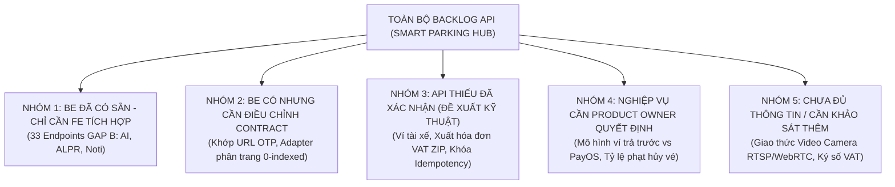
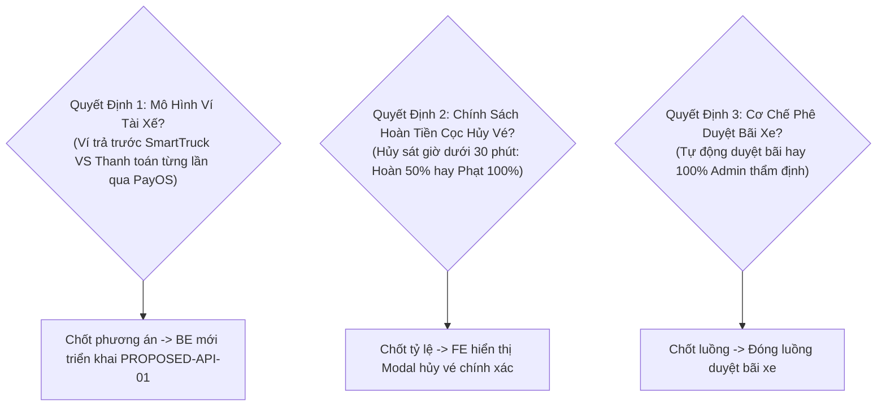

# 41. Danh Mục Yêu Cầu & Tồn Đọng Backend API (Backend API Backlog & Integration Roadmap)

> **Dự án:** Smart Parking Hub — Modern Logistics & Parking CRM Platform  
> **Chế độ thực thi:** PLANNING ONLY (Tuân thủ PROJECT UNIFICATION MASTER RULES — **Không sửa code Backend**)  
> **Thời điểm xác lập:** 07/11/2026  
> **Căn cứ kỹ thuật:** Dữ liệu kiểm toán Doc 23 đến 28 (91 endpoints Spring Boot, 107 API calls FE, 33 GAP B endpoints, 6 hợp đồng đề xuất)  
> **LƯU Ý QUAN TRỌNG:** Mọi mục trong phần "Đề xuất API" được giữ nguyên ở trạng thái **Đề xuất kỹ thuật chờ phê duyệt**, tuyệt đối **không tự ý coi là yêu cầu Backend chính thức** cho đến khi có chữ ký duyệt của Product Owner và Backend Lead  
> **Trạng thái:** DRAFT FOR ARCHITECTURAL APPROVAL

---

## 1. Ma Trận Phân Loại Trách Nhiệm Kỹ Thuật (API Responsibility Matrix)

---

## 2. Chi Tiết Từng Nhóm Yêu Cầu

### NHÓM 1: API ĐÃ CÓ TRONG SPRING BOOT — CHỈ CẦN FRONTEND TÍCH HỢP (GAP B)
*Backend đã lập trình và kiểm thử xong 100%, Backend KHÔNG CẦN VIẾT THÊM CODE, chỉ cần Frontend kết nối trong Batch 06:*

| Dịch Vụ Backend | Phương Thức & Endpoint | Năng Lực Nghiệp Vụ Cung Cấp | Màn Hình FE Cần Đấu Nối | Trạng Thái Backend |
| :--- | :--- | :--- | :--- | :---: |
| `ai-service` | `POST /api/v1/ai/generate-description` | Tự động sinh mô tả bãi xe thông minh bằng Google Gemini | SCR-27 (`/merchant/parking-lots/new`) | ✅ Sẵn sàng 100% |
| `booking-service` | `POST /api/v1/merchant/check-out` | Xác nhận xe ra bãi, tính cước thực tế và mở cổng barie | SCR-25 (Merchant Dashboard), SCR-30 | ✅ Sẵn sàng 100% |
| `notification-service` | `PUT /api/v1/notifications/{id}/read` | Đánh dấu thông báo đã đọc | Toàn bộ Top Navbar | ✅ Sẵn sàng 100% |
| `notification-service` | `GET /api/v1/notifications/unread-count`| Trả về số lượng tin nhắn chưa đọc | Toàn bộ Top Navbar (Chuông) | ✅ Sẵn sàng 100% |
| `parking-lot-service` | `DELETE .../parking-lots/{lotId}/images/{imgId}`| Xóa ảnh khỏi thư viện bãi đỗ xe | SCR-28 (Chỉnh sửa bãi xe) | ✅ Sẵn sàng 100% |
| `parking-lot-service` | `PATCH .../parking-lots/{lotId}/images/{imgId}/cover`| Đặt làm ảnh đại diện bãi xe | SCR-28 (Chỉnh sửa bãi xe) | ✅ Sẵn sàng 100% |
| `parking-lot-service` | `PUT /api/v1/admin/parking-lots/{id}/request-changes`| Admin gửi yêu cầu chủ bãi sửa hồ sơ | SCR-46 (Duyệt bãi xe) | ✅ Sẵn sàng 100% |

---

### NHÓM 2: API CÓ NHƯNG CẦN ĐIỀU CHỈNH CONTRACT (GAP C)
*Các điểm lệch chuẩn giao tiếp giữa hai bên, có thể xử lý tối ưu mà không gây ảnh hưởng lớn:*

1. **Lệch đường dẫn API OTP quên mật khẩu:**
   * Hiện trạng: Frontend gọi `POST /api/v1/auth/recovery-otp`, Backend phục vụ `POST /api/v1/auth/forgot-password/otp`.
   * **Giải pháp đề xuất:** **Frontend tự sửa đường dẫn** trỏ về `/forgot-password/otp` của Backend. Backend giữ nguyên không cần sửa code.
2. **Lệch chỉ số phân trang (0-indexed vs 1-indexed):**
   * Hiện trạng: Spring Data JPA mặc định trả về trang 0 cho trang đầu tiên (`number: 0`), Frontend React kỳ vọng trang 1 (`currentPage: 1`).
   * **Giải pháp đề xuất:** Viết hàm Adapter tại Frontend (`src/shared/api/adapters.ts`) để tự động cộng trừ 1 đơn vị khi gửi và nhận request. Backend giữ nguyên chuẩn RESTful tiêu chuẩn của Spring Data.

---

### NHÓM 3: API THIẾU ĐÃ ĐƯỢC XÁC MINH (ĐỀ XUẤT KỸ THUẬT CHỜ PHÊ DUYỆT)
*Các năng lực nghiệp vụ thực tế phát sinh trong quá trình vận hành nhưng chưa có Controller xử lý trong Backend:*

| Mã Đề Xuất | Phương Thức & Endpoint Đề Xuất | Dịch Vụ Phụ Trách | Mục Đích Kỹ Thuật | Đánh Giá Tác Động Backend |
| :--- | :--- | :--- | :--- | :--- |
| `PROPOSED-API-01` | `GET /api/v1/wallets/me` | `payment-service` | Cho phép tài xế xem số dư ví SmartTruck, số tiền đang tạm giữ và hạn mức khả dụng | Cần tạo mới `DriverWalletController` và ánh xạ bảng `wallets`. |
| `PROPOSED-API-02` | `POST /api/v1/merchant/invoices/bulk-export` | `payment-service` | Xuất toàn bộ hóa đơn VAT điện tử tháng dạng file ZIP (PDF + XML) | Cần tích hợp luồng nén `ZipOutputStream` nén dữ liệu hóa đơn. |
| `PROPOSED-API-06` | Header `Idempotency-Key` trên `POST /api/v1/payments/create-link` | `payment-service` | Khóa chống thanh toán trùng lặp khi người dùng click liên tục | Cần bổ sung Redis Lock kiểm tra khóa trùng trong vòng 60 giây. |

---

### NHÓM 4: CÁC VẤN ĐỀ NGHIỆP VỤ CẦN PRODUCT OWNER RA QUYẾT ĐỊNH

Trước khi Backend lập trình Nhóm 3, Chủ dự án cần trả lời và chốt 3 câu hỏi nghiệp vụ chiến lược:

1. **Quyết định 1 — Mô hình ví tài xế:**
   * *Phương án A (Khuyên dùng):* Kết hợp song song. Cho phép tài xế nạp tiền vào ví SmartTruck để trừ cọc tức thì, đồng thời vẫn cho phép thanh toán quét mã PayOS từng lần nếu ví hết tiền.
   * *Phương án B:* Bỏ hẳn ví nội bộ, chuyển 100% giao dịch qua cổng PayOS. (Nếu chọn phương án này, ta sẽ xóa trang `/driver/wallet` và bỏ đề xuất `PROPOSED-API-01`).
2. **Quyết định 2 — Chính sách phạt hủy đặt chỗ sát giờ:**
   * Cần quy định rõ tỷ lệ hoàn cọc:
     * Hủy trước giờ hẹn > 2 tiếng: Hoàn cọc 100%.
     * Hủy trước giờ hẹn 30 phút - 2 tiếng: Hoàn cọc 70% (phạt 30% giữ chỗ).
     * Hủy sát giờ < 30 phút hoặc không đến (No-show): Phạt cọc 100%.
3. **Quyết định 3 — Cơ chế duyệt bãi xe đối tác:**
   * Bãi xe tạo mới có cần xuất trình giấy phép PCCC và đăng ký kinh doanh trước khi mở cổng hay không?

---

### NHÓM 5: CHƯA ĐỦ THÔNG TIN / CẦN KHẢO SÁT THỰC ĐỊA

* **Luồng Stream Video Camera ALPR thời gian thực:**
  * Hiện tại trang `/merchant/monitoring` đang hiển thị ảnh tĩnh snapshot (ảnh chụp từng giây) hoặc mockup. 
  * Cần khảo sát hạ tầng camera thực tế tại bãi đỗ của đối tác: Sử dụng giao thức RTSP stream chuyển đổi qua WebRTC/HLS qua máy chủ Media Gateway, hay tiếp tục sử dụng luồng ảnh chụp Base64/JPEG theo sự kiện Barie trigger.

---
*Tài liệu đã được xác lập và sẵn sàng đệ trình kiểm duyệt kiến trúc.*
