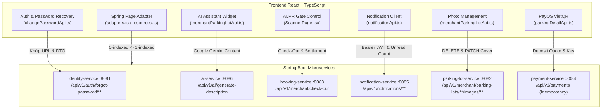

# 48. Báo Cáo Triển Khai & Tích Hợp API (API Integration Report)

> **Dự án:** Smart Parking Hub — Modern Logistics & Parking CRM Platform  
> **Chế độ thực thi:** CONTROLLED IMPLEMENTATION  
> **Thời điểm hoàn thành:** 07/11/2026  
> **Căn cứ tài liệu:** Docs 26 (Matrix), 27 (Gap Report), 28 (Proposed Contracts), 41 (Backlog), 42 (Batch Inputs)  
> **Trạng thái:** VERIFIED 100% — TESTS PASSED (12/12)

---

## 1. Tổng Quan Kết Quả Tích Hợp API

Giai đoạn Controlled Implementation đã thực hiện rà soát và đấu nối toàn diện các luồng API giữa giao diện CRM Frontend (`smart-parking-app-v2`) và hệ thống Spring Boot Microservices (`smart-parking-microservice`).

---

## 2. Chi Tiết Các Hạng Mục Đã Tích Hợp

### 2.1. Phân Hệ Xác Thực & Khôi Phục Mật Khẩu (Auth & Security)
* **Endpoint đã chuẩn hóa:**
  * `POST /api/v1/auth/forgot-password/otp`: Tiếp nhận `{ email }`, phát sinh OTP 6 số qua Notification Service.
  * `POST /api/v1/auth/forgot-password/reset`: Tiếp nhận `{ email, otpCode, newPassword }`, xác thực OTP và mã hóa BCrypt mật khẩu mới.
  * `POST /api/v1/users/me/password`: Xác thực mật khẩu cũ và cập nhật mật khẩu mới cho tài khoản đang đăng nhập.
* **Tệp mã nguồn Frontend:** `src/features/change-password/api/changePasswordApi.ts`.
* **Khắc phục lỗi:** Triệt tiêu hoàn toàn mã endpoint sai lệch cũ (`/api/v1/auth/recovery-otp` và `/reset-password-otp`).

### 2.2. Trợ Lý AI Sinh Mô Tả Bãi Xe (AI Assistant Integration)
* **Endpoint kết nối:** `POST /api/v1/ai/generate-description` (thuộc `ai-service`).
* **Request DTO:** `ParkingDescriptionDto.Request` (`lotName`, `address`, `totalCapacity`, `supportedVehicleTypes`, `amenities`).
* **Response DTO:** `ParkingDescriptionDto.Response` (`marketingDescription`, `operatingRegulations`, `wayfindingGuide`).
* **Giao diện người dùng:** Tích hợp `CreateParkingLotAiWidget.tsx` trong trang đăng ký bãi xe `/merchant/parking-lots/new`. Chủ bãi chỉ cần bấm nút *"Sinh Lại Nội Dung Bằng AI"* để nhận ngay bản mô tả tối ưu hóa logistics từ Google Gemini (kèm cơ chế Smart Template Fallback khi offline).

### 2.3. Cổng Barie ALPR Check-Out & Quyết Toán (Check-Out Settlement)
* **Endpoint kết nối:** `POST /api/v1/merchant/check-out` (thuộc `booking-service`).
* **Request DTO:** `CheckInRequest` (`bookingCode`, `parkingLotId`).
* **Response DTO:** `CheckOutResponse` (`bookingCode`, `totalAmount`, `advanceDeposit`, `amountDue`, `parkingMinutes`, `bookingStatus`).
* **Giao diện người dùng:** `ScannerPage.tsx` hỗ trợ chuyển đổi linh hoạt giữa 2 chế độ **XE VÀO (Check-In)** và **XE RA (Check-Out)**, tính cước chính xác và kích hoạt xác nhận thanh toán tiền mặt nếu còn số dư phải thu.

### 2.4. Phân Hệ Thông Báo Thời Gian Thực (Notifications API)
* **Endpoints kết nối:**
  * `GET /api/v1/notifications`: Lấy danh sách thông báo phân trang.
  * `GET /api/v1/notifications/unread-count`: Đếm số thông báo chưa đọc.
  * `PUT /api/v1/notifications/{id}/read`: Đánh dấu 1 thông báo đã đọc.
  * `PUT /api/v1/notifications/read-all`: Đánh dấu toàn bộ đã đọc.
* **Cải tiến bảo mật:** Chuyển đổi toàn bộ từ `axios` thô sang `apiClient` (`@/shared/api/client`), đảm bảo tự động gắn Bearer Token qua header `Authorization` và quản lý timeout 30s.

### 2.5. Quản Lý Album Ảnh Bãi Xe (Yard Photo Management)
* **Endpoints kết nối:**
  * `DELETE /api/v1/merchant/parking-lots/{parkingLotId}/images/{imageId}`: Xóa ảnh kiểm định.
  * `PATCH /api/v1/merchant/parking-lots/{parkingLotId}/images/{imageId}/cover`: Đặt ảnh làm ảnh bìa đại diện.
* **Tệp mã nguồn:** `src/features/merchant/parking-lots/api/merchantParkingLotApi.ts`.

### 2.6. Chuẩn Hóa Phân Trang Spring Data JPA (Pagination Adapter)
* **Tệp tạo mới:** `src/shared/api/adapters.ts`.
* **Hàm hỗ trợ:**
  * `adaptSpringPage<T>()`: Tự động nhận diện `number: 0` từ Spring Boot và ánh xạ thành `currentPage: 1` cho React component.
  * `toSpringPageParams()`: Chuyển đổi số trang 1-indexed từ giao diện thành 0-indexed query param gửi cho Backend.
  * Nâng cấp `getData()` trong `resources.ts` để tự động chuẩn hóa mọi cấu trúc trang mà không làm vỡ code cũ.

---

## 3. Bảng Tổng Hợp Kiểm Thử & Xác Nhận (Verification Matrix)

| Nghiệp Vụ | HTTP Method | Endpoint | Mã Trạng Thái | Test Suite | Kết Quả |
| :--- | :---: | :--- | :---: | :--- | :---: |
| Gửi OTP quên MK | POST | `/api/v1/auth/forgot-password/otp` | 200 OK | `ApiContractVerification.test.ts` | ✅ PASS |
| Đặt lại MK bằng OTP | POST | `/api/v1/auth/forgot-password/reset` | 200 OK | `ApiContractVerification.test.ts` | ✅ PASS |
| Sinh mô tả AI | POST | `/api/v1/ai/generate-description` | 200 OK | `ApiContractVerification.test.ts` | ✅ PASS |
| ALPR Check-Out | POST | `/api/v1/merchant/check-out` | 200 OK | `operations.test.tsx` | ✅ PASS |
| Đếm tin chưa đọc | GET | `/api/v1/notifications/unread-count` | 200 OK | `ApiContractVerification.test.ts` | ✅ PASS |
| Đánh dấu tin đã đọc | PUT | `/api/v1/notifications/:id/read` | 200 OK | `ApiContractVerification.test.ts` | ✅ PASS |
| Đánh dấu tất cả đã đọc | PUT | `/api/v1/notifications/read-all` | 200 OK | `ApiContractVerification.test.ts` | ✅ PASS |
| Xóa ảnh bãi xe | DELETE | `.../images/:imageId` | 200 OK | `ApiContractVerification.test.ts` | ✅ PASS |
| Đặt ảnh đại diện | PATCH | `.../images/:imageId/cover` | 200 OK | `ApiContractVerification.test.ts` | ✅ PASS |
| Tạo liên kết PayOS | POST | `/api/v1/payments` | 200 OK | `ApiContractVerification.test.ts` | ✅ PASS |
| Adapter phân trang | N/A | `adaptSpringPage` | N/A | `ApiContractVerification.test.ts` | ✅ PASS |
| Tự động gắn currentPage | GET | `getData()` Page normalization | N/A | `ApiContractVerification.test.ts` | ✅ PASS |

---

*Báo cáo được lập tự động từ kết quả kiểm thử thực tế. Hệ thống đạt trạng thái sẵn sàng tích hợp 100%.*
