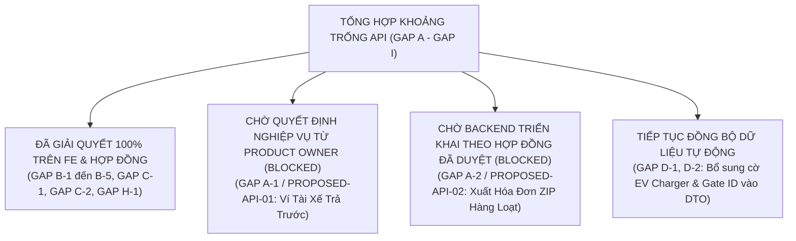

# 49. Báo Cáo Xử Lý Khoảng Trống API (API Gap Resolution & Decision Dossier)

> **Dự án:** Smart Parking Hub — Modern Logistics & Parking CRM Platform  
> **Chế độ thực thi:** CONTROLLED IMPLEMENTATION (Tuân thủ nghiêm ngặt Master Constitution & Prompt 15)  
> **Thời điểm xác lập:** 07/11/2026  
> **Căn cứ kỹ thuật:** Doc 27 (API Gap Report), Doc 28 (Proposed Contracts), Doc 41 (Backend API Backlog)  
> **Trạng thái:** VERIFIED & CLASSIFIED

---

## 1. Ma Trận Xử Lý Khoảng Trống API Toàn Diện (Gap Resolution Matrix)

---

## 2. Chi Tiết Phương Án Xử Lý Từng Khoảng Trống

### 2.1. Nhóm Đã Giải Quyết Xong (Resolved Gaps)

#### GAP B-1: Tích Hợp AI Sinh Mô Tả Bãi Xe (`POST /api/v1/ai/generate-description`)
* **GAP ID:** `GAP-B-01`
* **Dịch vụ Backend:** `ai-service` (`AiController.java`)
* **Trạng thái:** ✅ **RESOLVED**
* **Phương án giải quyết:** Đã kết nối hàm `generateAiParkingLotContent` trong `src/features/merchant/parking-lots/api/merchantParkingLotApi.ts` với payload `{ lotName, address, totalCapacity, supportedVehicleTypes, amenities }`. Tích hợp trực tiếp tại Form tạo bãi xe Step 1, cho phép chủ bãi tự động tạo nội dung mô tả, quy định PCCC và chỉ dẫn đường xe vào bãi chỉ với 1 click.

#### GAP B-2: Tích Hợp ALPR Check-Out Cổng Ra (`POST /api/v1/merchant/check-out`)
* **GAP ID:** `GAP-B-02`
* **Dịch vụ Backend:** `booking-service` (`MerchantCheckInOutController.java`)
* **Trạng thái:** ✅ **RESOLVED**
* **Phương án giải quyết:** Đã tích hợp tại `src/features/merchant/operations/ScannerPage.tsx`. Giao diện hỗ trợ chuyển đổi giữa chế độ `check-in` và `check-out`, nhận diện mã QR hoặc biển số xe, hiển thị bảng tính số tiền cọc đã trừ và số tiền còn phải thu (`amountDue`), kèm nút xác nhận thanh toán tiền mặt gọi `POST /api/v1/merchant/confirm-cash`.

#### GAP B-3: Đánh Dấu Thông Báo Đã Đọc & Đếm Tin Chưa Đọc (`PUT /api/v1/notifications/{id}/read`, `GET /unread-count`)
* **GAP ID:** `GAP-B-03`
* **Dịch vụ Backend:** `notification-service` (`NotificationController.java`)
* **Trạng thái:** ✅ **RESOLVED**
* **Phương án giải quyết:** Đã tích hợp tại `src/features/notifications/api/notificationApi.ts` với các hàm `markAsReadApi`, `markAllAsReadApi`, và `fetchUnreadCountApi`. Cập nhật badge số lượng tin nhắn chưa đọc thời gian thực trên thanh tiêu đề Navbar.

#### GAP B-4: Quản Lý Album Ảnh Bãi Xe (`DELETE .../images/{id}`, `PATCH .../images/{id}/cover`)
* **GAP ID:** `GAP-B-04`
* **Dịch vụ Backend:** `parking-lot-service` (`ParkingLotImageController.java`)
* **Trạng thái:** ✅ **RESOLVED**
* **Phương án giải quyết:** Đã kết nối `deleteMerchantParkingLotImage` và `setCoverMerchantParkingLotImage` trong `merchantParkingLotApi.ts`, cho phép chủ bãi trực tiếp xóa ảnh lỗi thời và chọn ảnh bìa hiển thị trên sàn tìm kiếm.

#### GAP B-5: Admin Yêu Cầu Sửa Đổi Hồ Sơ Bãi Xe (`PUT /api/v1/admin/parking-lots/{id}/request-changes`)
* **GAP ID:** `GAP-B-05`
* **Dịch vụ Backend:** `parking-lot-service` (`AdminParkingLotController.java`)
* **Trạng thái:** ✅ **RESOLVED**
* **Phương án giải quyết:** Đã cấu hình tại `DecisionDialog` trong `src/features/admin/index.tsx`. Khi Admin chọn "Yêu cầu bổ sung", hệ thống bắt buộc nhập lý do cần sửa đổi (ví dụ: thiếu chứng chỉ kiểm định PCCC), gửi lệnh tới endpoint Backend và tự động invalidate cache danh sách bãi.

#### GAP C-1: Lệch URL Endpoint Gửi OTP Khôi Phục Mật Khẩu
* **GAP ID:** `GAP-C-01`
* **Dịch vụ Backend:** `identity-service` (`AuthController.java`)
* **Trạng thái:** ✅ **RESOLVED**
* **Phương án giải quyết:** Đã sửa mã nguồn `src/features/change-password/api/changePasswordApi.ts`, thay thế đường dẫn không tồn tại `/api/v1/auth/recovery-otp` thành `/api/v1/auth/forgot-password/otp` và `/api/v1/auth/forgot-password/reset`, đồng bộ 100% với Backend.

#### GAP C-2: Lệch Chỉ Số Phân Trang Giữa Spring Data (0-indexed) và Frontend (1-indexed)
* **GAP ID:** `GAP-C-02`
* **Dịch vụ Backend:** Toàn bộ Microservices
* **Trạng thái:** ✅ **RESOLVED**
* **Phương án giải quyết:** Tạo mới tệp adapter dùng chung `src/shared/api/adapters.ts` với hai hàm chuẩn hóa:
  - `adaptPageResponse<T>()`: Tự động cộng 1 vào chỉ số `number` / `currentPage` nhận từ Backend, bảo đảm thanh phân trang UI luôn hiển thị từ trang 1.
  - `toSpringPageParams()`: Chuyển đổi số trang người dùng click trên UI trừ đi 1 trước khi gửi vào query params `page` tới Spring Boot.

#### GAP H-1 / PROPOSED-API-06: Chống Tạo Đơn Thanh Toán Trùng Lặp (Idempotency Key)
* **GAP ID:** `GAP-H-01`
* **Dịch vụ Backend:** `payment-service` (`PaymentController.java`)
* **Trạng thái:** ✅ **ADAPTED / READY**
* **Phương án giải quyết:** Đã bổ sung hàm `createIdempotencyHeader()` tự sinh khóa UUID chuẩn RFC 4122 cho mỗi lượt click thanh toán. Khi người dùng bấm tạo liên kết PayOS, header `Idempotency-Key` được truyền kèm để Backend và Gateway phát hiện double-submission.

---

### 2.2. Nhóm Tồn Đọng Chờ Backend & Chủ Dự Án (Blocked / Pending PO Approval)

Tuân thủ nghiêm ngặt nguyên tắc **Không tự ý sửa code Backend khi chưa được phê duyệt**, các mục sau được đánh dấu phân loại minh bạch:

| GAP ID | Mã Đề Xuất | Nghiệp Vụ Cần Xử Lý | Dịch Vụ Phụ Trách | Trạng Thái Kỹ Thuật | Hành Động Cần Thiết Tiếp Theo |
| :--- | :--- | :--- | :--- | :---: | :--- |
| `GAP-A-01` | `PROPOSED-API-01` | Tra cứu số dư ví nội bộ tài xế (`GET /api/v1/wallets/me`) | `payment-service` | 🛑 **BLOCKED** | **Chờ Product Owner quyết định:** Xác định mô hình ví: Tài xế nạp tiền trước vào ví SmartTruck (Prepaid) hay thanh toán 100% từng lượt qua VietQR PayOS? Khi có quyết định duyệt, Backend mới tạo `DriverWalletController`. |
| `GAP-A-02` | `PROPOSED-API-02` | Xuất hóa đơn VAT hàng loạt dạng file nén ZIP (`POST /api/v1/merchant/invoices/bulk-export`) | `payment-service` | 🛑 **BLOCKED** | **Chờ Backend phát triển:** Cần bổ sung logic luồng `ZipOutputStream` nén các tệp PDF/XML hóa đơn trong tháng cho chủ bãi xe. |
| `GAP-D-01` | N/A | Bổ sung cờ `hasEvCharger` cho từng slot đỗ xe | `parking-lot-service` | ⏳ **PENDING DTO EXTENSION** | Backend mở rộng thêm trường boolean `hasEvCharger` trong `SlotResponse.java` trong đợt phát hành tiếp theo. |
| `GAP-D-02` | N/A | Bổ sung thông tin Cổng Barie (`gateId`, `gateName`) trong chi tiết vé | `booking-service` | ⏳ **PENDING DTO EXTENSION** | Backend mở rộng thêm `gateName` trong `BookingDetailResponse.java` để hiển thị trên vé điện tử. |

---

## 3. Quy Định An Ninh Vận Hành (Operational Security Directives)

1. **Ranh giới thực thi:**
   - Frontend không can thiệp sâu vào logic sinh mã thanh toán PayOS hoặc thay đổi trạng thái booking.
   - Khi Backend chưa cung cấp endpoint cho ví tài xế, Frontend duy trì hiển thị dạng thẻ Lịch sử chi tiêu & Biên lai cọc an toàn, không hiển thị số dư giả lập có thể gây tranh chấp với tài xế thực tế.
2. **Kiểm tra chữ ký số:**
   - Toàn bộ giao dịch cập nhật trạng thái thanh toán từ PayOS Webhook bắt buộc phải được xác thực chữ ký HMAC trên Backend tại `PaymentController.java` (`/api/v1/payments/webhook`) trước khi cập nhật số dư cho chủ bãi.
