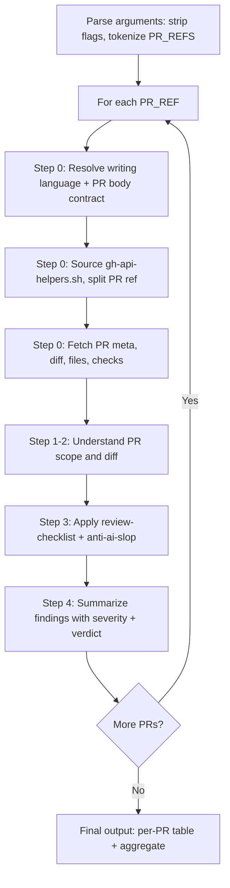
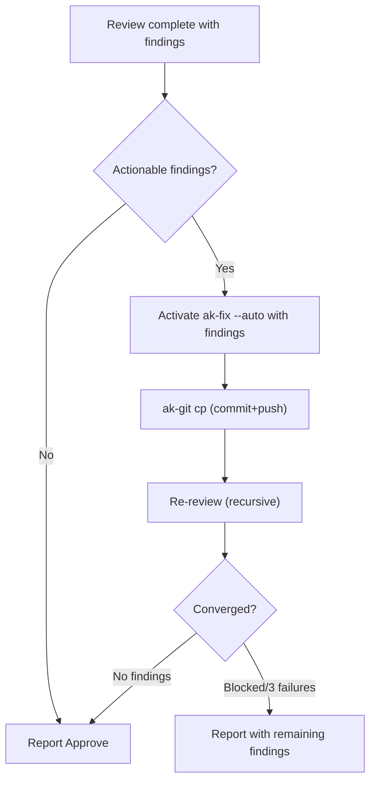

# 01 — Project Context & Change Inventory for `ak-review-pr` Skill Rebuild

> **Generated**: 2026-11-11T00:15 ICT (UTC+7)  
> **Purpose**: Read-only discovery report to inform the redesign of the `ak-review-pr` skill for the SmartParkingHub workspace.  
> **Author**: AI Architect (discovery phase — no files were modified)

---

## 1. Executive Summary

The `ak-review-pr` skill (v2.6.2, authored by "agentkit") has been extracted and placed at the workspace root of SmartParkingHub — a multi-project workspace comprising a **React 19 + Vite + TypeScript + Tailwind CSS v4 CRM frontend** and a **Java 21 Spring Boot 3.x microservices backend**. The skill was designed for the **Claude Code / AgentKit** ecosystem (Claude Desktop, Claude Cloud Environment, `gh` CLI, Bash shell helpers, `ak-fix`/`ak-git`/`ak-brainstorm`/`kongming` companion skills). It is **not natively compatible** with the current Antigravity runtime:

| Gap | Impact |
|-----|--------|
| `allowed-tools` uses `Bash(…)` syntax — Antigravity uses different tool names and permission model | Skill tools will not be granted at runtime |
| `gh` CLI is **not installed** on this Windows machine | All GitHub API operations will fail |
| Shell helpers are Bash-only (`gh-api-helpers.sh`) — WSL bash exists but `gh` is still absent inside it | No fallback path |
| External skill dependencies (`ak-fix`, `ak-git`, `ak-brainstorm`, `kongming`) do **not exist** anywhere in this workspace or Antigravity config | Fix loop, merge mode, advice mode, ultra mode all non-functional |
| Helper CJS scripts (`writing-language.cjs`, `pr-body-contract.cjs`) do **not exist** in any project path | Language resolution and PR body validation will fail |
| Skill path references use `.claude/skills/…` and `kits/engineer/skills/…` — neither directory exists | Library loader will fail with "not found" |

**No evidence of user modifications** to the skill content itself was found — the skill appears to be a pristine extraction from the AgentKit distribution. There is **no git history** for the root workspace (SmartParkingHub root is not a git repository), and the sub-project repos contain no references to `ak-review-pr`.

The project has **extensive AI agent governance** (AGENTS.md constitutions, 15+ numbered rules, 12+ custom skills, 8+ workflows) that any review skill must respect. Both sub-projects have strict review conventions, Vietnamese-language documentation, and project-specific coding standards that a rebuilt skill should incorporate.

---

## 2. Repository Overview

### 2.1 Structure

```
SmartParkingHub/                          ← Workspace root (NOT a git repo)
├── AGENTS.md                             ← Master workspace constitution
├── .agents/                              ← Workspace-level agent config
│   ├── prompts/
│   ├── rules/
│   │   ├── 01-git-commit-and-branching-standards.md
│   │   └── 15-stitch-screen-by-screen.md
│   └── skills/
│       └── design-taste-frontend/        ← UI design taste skill
├── ak-review-pr/                         ← *** TARGET SKILL (extracted) ***
│   ├── SKILL.md
│   └── references/ (12 files)
├── docs/                                 ← Workspace-level documentation
│   ├── archive/
│   └── project-unification/ (54 docs)
├── smart-parking-app-v2/                 ← Frontend (own git repo, branch: main)
│   ├── AGENTS.md                         ← Frontend constitution (233 lines)
│   ├── .agents/ (rules, skills, workflows, templates)
│   ├── .github/workflows/frontend-quality-gate.yml
│   ├── src/
│   └── package.json
├── smart-parking-microservice/           ← Backend (own git repo, branch: main)
│   ├── AGENTS.md                         ← Backend constitution (Vietnamese, 63 lines)
│   ├── .agents/ (rules, skills, workflows, templates)
│   ├── .github/workflows/ (ci-build.yml, cd-deploy.yml)
│   └── build.gradle
└── .taste-skill/                         ← Design taste skill data
```

### 2.2 Sub-project Git Status

| Sub-project | Branch | Git Root | Modified Files | Untracked Files |
|------------|--------|----------|----------------|-----------------|
| `smart-parking-app-v2` | `main` | `D:/Documents/JAVA WEB SERVICE/SmartParkingHub/smart-parking-app-v2` | 2 (sprint backlog, test file) | 1 (sprint planning doc) |
| `smart-parking-microservice` | `main` | `D:/Documents/JAVA WEB SERVICE/SmartParkingHub/smart-parking-microservice` | 1 (trello snapshot) | 12 (trello automation scripts) |

**Status**: CONFIRMED — Both repos are on `main` with minor local changes unrelated to the skill.

### 2.3 Technology Stack

| Layer | Technology | Version | Evidence |
|-------|-----------|---------|----------|
| **Frontend framework** | React | 19.0.0 | `package.json` |
| **Build tool** | Vite | 6.2.0 | `package.json` |
| **Language** | TypeScript | 5.7.3 | `package.json` |
| **CSS** | Tailwind CSS | 4.3.4 | `package.json` |
| **State (server)** | TanStack Query | 5.67.1 | `package.json`, ADR-0001 |
| **State (client)** | Redux Toolkit | 2.6.1 | `package.json`, ADR-0001 |
| **Forms** | React Hook Form + Zod | 7.54.2 / 3.24.2 | `package.json` |
| **Test** | Vitest + Testing Library + Playwright | 3.0.7 / 16.2.0 / 1.64.1 | `package.json` |
| **Backend** | Java 21 LTS + Spring Boot 3.x | 21.0.9 | `AGENTS.md`, gradle config |
| **Build (backend)** | Gradle multi-project | — | `build.gradle`, `settings.gradle` |
| **Containers** | Docker + Docker Compose | — | `cd-deploy.yml`, compose files |
| **CI/CD** | GitHub Actions | — | `.github/workflows/` |
| **Deployment** | 3 VPS (Edge, Data, Core) via SSH | — | `cd-deploy.yml` |

### 2.4 Runtime Environment (Local Dev Machine)

| Component | Status | Evidence |
|-----------|--------|----------|
| OS | Windows 11 (10.0.22621.0) | `[Environment]::OSVersion` |
| Node.js | v22.18.0 ✅ | `node --version` |
| npm | 10.9.3 ✅ | `npm --version` |
| Java | 21.0.9 LTS ✅ | `java -version` |
| Bash | Available (WSL) | `where.exe bash` → `C:\Windows\System32\bash.exe` |
| **`gh` CLI** | **❌ NOT INSTALLED** | `where.exe gh` → not found |
| Git | Available ✅ | git commands work in sub-projects |

---

## 3. Current Architecture

### 3.1 Workspace Governance Hierarchy

```
AGENTS.md (Root — Master Constitution)
├── Rule: Stitch Screen Protocol (single-screen, 8-phase, 13 rules)
├── → smart-parking-app-v2/AGENTS.md (Frontend Constitution)
│   ├── 15 numbered rules (.agents/rules/00 through 15)
│   ├── 12 custom skills (.agents/skills/)
│   ├── 8 workflows (.agents/workflows/)
│   └── 4 templates (.agents/templates/)
└── → smart-parking-microservice/AGENTS.md (Backend Constitution, Vietnamese)
    ├── 9 numbered rules (.agents/rules/01 through 09)
    ├── 4 custom skills (.agents/skills/)
    ├── 6 workflows (.agents/workflows/)
    └── 3 templates (.agents/templates/)
```

### 3.2 Frontend Architecture (4-Layer)

- `app/` — Bootstrap, providers, router, global config
- `features/` — Business capabilities (auth, merchant, landing, driver, admin, etc.)
- `entities/` — Shared domain concepts
- `shared/` — Domain-agnostic UI, API infrastructure, hooks, utilities

**Dependency direction**: `app` → `features` → `entities` → `shared` (no reverse imports)

### 3.3 Backend Architecture (Microservices)

Services: `api-gateway`, `identity-service`, `parking-lot-service`, `booking-service`, `payment-service`, `notification-service`, `ai-service`, `config-server`, `discovery-server`, `common-library`

**Principles**: Database-per-Service, Clean/Hexagonal Architecture, DDD, Outbox Pattern, Saga Coordinator

### 3.4 CI/CD Pipelines

| Pipeline | Trigger | Steps |
|----------|---------|-------|
| Frontend Quality Gate | PR/push to `main`/`develop` | `npm ci` → TypeScript typecheck → ESLint → Vitest → Vite build |
| Backend CI Build | PR/push to `main`/`develop` | Gradle build → Gradle test |
| Backend CD Deploy | Push to `main` | Build JARs → Docker images → Deploy to 3 VPS via SSH |

---

## 4. Skill Location and Structure

### 4.1 Location

```
D:\Documents\JAVA WEB SERVICE\SmartParkingHub\ak-review-pr\
```

**Placement**: At workspace root, **outside** both sub-project git repositories. Not tracked by any git repo. Not in `.agents/skills/`. Not in any recognized Antigravity skill discovery path (`.agents/skills/`, Antigravity plugin directory, or `~/.gemini/config/plugins/`).

**Status**: CONFIRMED — The skill directory exists at the root, timestamped 2026-11-11 00:10 (fresh extraction).

### 4.2 File Inventory

| # | File | Size | Function | Used By | References To | Dependencies | Key Rules | Upgrade Notes |
|---|------|------|----------|---------|--------------|-------------|-----------|---------------|
| 1 | `SKILL.md` | 6,078 B | Main skill definition with frontmatter, modes, argument parsing, and orchestration flow | Antigravity/Claude Code runtime (skill loader) | All reference files; `ak-fix`, `ak-git`, `ak-brainstorm`, `kongming` | `gh` CLI, Bash, Node.js | 7 composable modes; multi-PR sequential; argument tokenization via sed/awk | Frontmatter `allowed-tools` incompatible with Antigravity; `Bash(…)` tool names don't exist |
| 2 | `references/review-workflow.md` | 4,594 B | Per-PR review execution: context loading, diff inspection, finding format, verdict criteria | SKILL.md step-by-step instructions | `gh-api-helpers.sh`, `writing-language.cjs`, `pr-body-contract.cjs`, `review-checklist.md`, `anti-ai-slop.md` | `writing-language.cjs` (Node.js), `pr-body-contract.cjs` (Node.js), `gh-api-helpers.sh` (Bash) | 4-step review flow; finding severities: Critical/Important/Suggestion; anti-slop severity mapping | CJS helpers don't exist; writing-language resolution uses AgentKit-specific config paths |
| 3 | `references/gh-api-helpers.sh` | 6,763 B | Bash shell library: GraphQL/REST adaptive helpers for GitHub API (`_ak_probe_gh_api`, `_ak_split_pr`, `_ak_pr_meta/diff/files/checks/body/review/comment`) | All modes that interact with GitHub | `gh` CLI, git remotes | `gh` CLI authenticated, Bash 4+, git remote named `upstream` or `origin` pointing to github.com | Idempotent probe; native-first-then-REST fallback; supports Claude Cloud Environment proxy restrictions | `gh` not installed on this machine; Bash-only (no PowerShell equivalent); loader paths reference `.claude/skills/` and `kits/engineer/skills/` |
| 4 | `references/gh-api-compatibility.md` | 3,917 B | Documentation: GraphQL-blocked environments, library loader snippet, function table, merge/self-PR caveats | SKILL.md; mode-reply.md; mode-merge.md | `gh-api-helpers.sh` | — | Loader tries 4 paths: `.claude/skills/`, `~/.claude/skills/`, `kits/engineer/skills/`, `$CLAUDE_PLUGIN_ROOT/skills/` | All 4 paths are Claude Code specific; need Antigravity-native path |
| 5 | `references/review-checklist.md` | 2,086 B | Review checklist: correctness, security, performance, breaking changes, anti-slop terse checklist, project-specific compliance | review-workflow.md step 3 | `anti-ai-slop.md` | — | Triggers full anti-slop taxonomy on >300 LOC added, ≥2 inline flags, or >2 new files in utils; project-specific compliance via loaded instructions | Generic — good content to preserve |
| 6 | `references/anti-ai-slop.md` | 4,549 B | Full anti-AI-slop taxonomy: structural slop (Important), micro slop (Suggestion), process slop (Important), phrasing guidelines, when-not-to-flag exceptions | review-checklist.md; review-workflow.md step 3 | — | — | 7 structural patterns, 8 micro patterns, 4 process patterns; concrete cost requirement; exception rules | High-value content — preserve entirely |
| 7 | `references/mode-fix.md` | 2,043 B | Fix loop mode: decide → activate `ak-fix --auto` → `ak-git cp` → re-review loop | SKILL.md when `--fix` | `ak-fix`, `ak-git` (external skills) | `ak-fix` skill, `ak-git` skill | Stop on: no findings, blocked decision, 3 failed attempts, unresolvable CI | `ak-fix` and `ak-git` don't exist — entire fix loop non-functional |
| 8 | `references/mode-reply.md` | 3,794 B | Reply mode: pre-flight → build review body → verdict→event mapping → self-PR fallback → composition with fix → idempotency | SKILL.md when `--reply` | `gh-api-helpers.sh`, `writing-language.md` | `gh` CLI, `_ak_pr_review` helper | 60K char cap; self-PR 422 downgrade to COMMENT; final-review-only in fix+reply | Requires `gh` auth; body format is portable |
| 9 | `references/mode-merge.md` | 4,053 B | Merge mode: 5-condition readiness gate → `ak-git merge-pr` handoff → post-merge CI watch → advisory post-CI comment | SKILL.md when `--merge` | `ak-git merge-pr`, `gh-api-helpers.sh`, `kongming` (for advice) | `ak-git` skill, `gh` CLI | Never force-merge; 5 conditions all must pass; post-merge CI watch is blocking | `ak-git merge-pr` doesn't exist — merge mode non-functional |
| 10 | `references/advanced-review-modes.md` | 3,752 B | Advisory (`--advice`) and Ultra Verifier (`--ultra`) modes: kongming checkpoints, best-of-5 verifier pass | SKILL.md when `--advice` or `--ultra` | `../../ak-brainstorm/references/advisory-supervision.md`, `../../ak-brainstorm/references/ultra-verifier-mode.md`, `kongming` | `ak-brainstorm` skill, `kongming` agent | 5 advisory checkpoints per PR; empty-counsel fallback; ultra = 5 independent candidate reviews + verifier | `ak-brainstorm` and `kongming` don't exist — both modes non-functional |
| 11 | `references/pr-body-contract.md` | 1,978 B | PR body validation contract: 7 required sections, traceability fields, review-pr validation rules | review-workflow.md step 0 | `pr-body-contract.cjs` (validator) | Node.js, `pr-body-contract.cjs` | Missing sections → Important finding; unsupported claims → Important; missing links → Suggestion | CJS validator doesn't exist; contract spec is valuable for review quality |
| 12 | `references/writing-language.md` | 1,807 B | I18n resolution: 7-level precedence for writing language, localized vs intact elements | review-workflow.md step 0 | `writing-language.cjs` (resolver) | Node.js, `writing-language.cjs` | BCP47 normalization; invalid tags skipped; YAML parser limits | CJS resolver doesn't exist; AgentKit-specific config paths; Vietnamese is likely the desired language for this project |
| 13 | `references/semantic-triage.md` | 1,329 B | Optional finding triage experiment: shadow mode, provider consent, benchmark measurement | SKILL.md (experimental, opt-in) | `ak eval triage` (CLI tool) | `ak eval` CLI | User opt-in only; never auto-run; secret scrubbing; frozen shadow receipts | `ak eval` doesn't exist — feature is non-functional |

---

## 5. Change Inventory

### 5.A Confirmed Modifications

**None found.** No evidence of modifications to any skill file.

- The workspace root (`SmartParkingHub/`) is not a git repository — no `git diff` or `git log` available for the extracted skill directory.
- No prior copy of the skill exists anywhere in the workspace to compare against.
- All files have the same timestamp (2026-11-11 00:10), consistent with a fresh extraction.
- File sizes are internally consistent with each other's cross-references.

**Confidence**: HIGH — The skill appears to be an unmodified extraction from the AgentKit v2.6.2 distribution.

### 5.B Added Custom Features

**None found.** No project-specific additions detected in the skill files.

- No SmartParkingHub-specific rules, paths, or configurations in any skill file.
- No Vietnamese language content in any skill file.
- No references to project-specific services, modules, or conventions.

**Confidence**: HIGH

### 5.C Removed or Replaced Behaviors

**Cannot determine** — no baseline distribution to compare against.

**Confidence**: N/A (Unknown baseline — see 5.F)

### 5.D Project-Specific Customizations

**None found** in the skill itself. However, the **project has extensive customizations** that the skill does not yet incorporate:

1. **Vietnamese writing language** — The backend AGENTS.md is entirely in Vietnamese. The frontend rules mix English headings with Vietnamese body text. The `writing-language.md` reference supports Vietnamese via BCP47 `vi`, but the resolver (`writing-language.cjs`) doesn't exist.

2. **Project code-review skill** — `smart-parking-app-v2/.agents/skills/code-review/SKILL.md` defines a project-specific 8-point review order (business correctness, security, API contracts, architecture boundaries, state/cache, accessibility, tests, maintainability) with severity labels `Blocker/Critical/Major/Minor` — different from `ak-review-pr`'s `Critical/Important/Suggestion`.

3. **Stitch screen protocol** — The project has a constitutional rule requiring specific 8-phase, 13-rule execution for any UI screen work, including PR review of such changes.

**Confidence**: HIGH — Based on direct file inspection.

### 5.E Potential Changes

**None identified.**

### 5.F Unknown Baseline

The skill files were extracted from an AgentKit distribution (version "2.6.2" per frontmatter metadata). **No original distribution archive was found** in the workspace. Without the original, we cannot:

- Confirm no lines were modified
- Identify subtle edits (e.g., path adjustments, rule modifications)
- Compare against older versions

**Recommendation**: If the AgentKit v2.6.2 source is available, perform a `diff` against the extracted files to confirm pristine status.

---

## 6. Project Customizations (External to Skill)

### 6.1 Review-Relevant Conventions

| Convention | Source | Impact on Skill |
|-----------|--------|-----------------|
| Severity labels: `Blocker/Critical/Major/Minor` | `smart-parking-app-v2/.agents/skills/code-review/SKILL.md` | Conflicts with skill's `Critical/Important/Suggestion` — need alignment |
| Evidence classification: `VERIFIED/ASSUMED/UNKNOWN/CONFLICT/DEPRECATED` | `smart-parking-app-v2/AGENTS.md` §3 | Skill should classify findings this way |
| Evidence hierarchy (7 levels) | `smart-parking-app-v2/AGENTS.md` §3 | Skill should respect this when evaluating code |
| Non-negotiable rules (12 items) | `smart-parking-app-v2/AGENTS.md` §4 | Skill review checklist should include these |
| Architecture boundaries (4-layer, dependency direction) | `smart-parking-app-v2/AGENTS.md` §6 | Skill should detect violations |
| Mandatory reading order (9 steps) | `smart-parking-app-v2/AGENTS.md` §2 | Skill should verify PR compliance |
| Quality gates (8 items) | `smart-parking-app-v2/AGENTS.md` §10 | Skill should verify these were run |
| Database-per-Service rule | `smart-parking-microservice/AGENTS.md` §1 | Cross-database query detection |
| 5-question tech decision gate | Backend `AGENT-TECH-DECISION-POLICY.md` | New dependency reviews |
| Conventional Commits with detailed body | `.agents/rules/01-git-commit-and-branching-standards.md` | PR commit quality check |
| Single branch lifecycle | `smart-parking-app-v2/.agents/rules/13-git-and-collaboration.md` | Branch naming/reuse validation |
| Stitch protocol (13 rules, 8 phases) | Multiple sources | UI PR compliance check |

### 6.2 Vietnamese Language Usage

The project extensively uses Vietnamese in:
- Backend AGENTS.md (entirely Vietnamese)
- Root-level rules (Vietnamese with English headings)
- Frontend rules 15 (Vietnamese body)
- Commit message guidance (Vietnamese examples)
- Documentation (Vietnamese content in docs/)

**Implication**: The skill's `writing-language.md` reference supports this, but the runtime resolver doesn't exist. The rebuilt skill should default to Vietnamese for this project or use the Antigravity locale mechanism.

---

## 7. Skill Integration and Runtime

### 7.1 Current Skill Placement

| Aspect | Current State | Required State |
|--------|--------------|----------------|
| Location | `SmartParkingHub/ak-review-pr/` (workspace root) | Antigravity skill directory (`.agents/skills/` or plugin) |
| Git tracking | Not tracked (root is not a git repo) | Should be in a tracked location |
| Discovery | Not discoverable by Antigravity runtime | Must be in Antigravity skill path |
| Frontmatter format | AgentKit YAML frontmatter with `allowed-tools: [Bash(…)]` | Antigravity frontmatter format |

### 7.2 Tool Permission Model

The skill's `allowed-tools` field uses Claude Code/AgentKit syntax:

```yaml
allowed-tools:
  - Bash(gh pr view *)
  - Bash(gh pr diff *)
  # ... etc
  - Read
  - Edit
  - Write
  - Glob
  - Grep
  - Task
```

**Antigravity equivalents**: Antigravity uses `run_command`, `read_file`, `write_file`, `edit_file`, and similar tools. The `Bash(…)` pattern syntax does not exist. The skill cannot restrict tool usage in the same granular way.

### 7.3 External Skill Dependencies

| Dependency | Used In | Exists? | Impact |
|-----------|---------|---------|--------|
| `ak-fix --auto` | `mode-fix.md` (fix loop) | ❌ No | Fix loop entirely non-functional |
| `ak-git cp` | `mode-fix.md` (commit+push) | ❌ No | Cannot commit fixes |
| `ak-git merge-pr` | `mode-merge.md` (merge) | ❌ No | Merge mode entirely non-functional |
| `ak-brainstorm` / `kongming` | `advanced-review-modes.md` | ❌ No | Advice and ultra modes entirely non-functional |
| `ak eval triage` | `semantic-triage.md` | ❌ No | Experimental triage non-functional |
| `writing-language.cjs` | `review-workflow.md`, `writing-language.md` | ❌ No | Language resolution fails |
| `pr-body-contract.cjs` | `review-workflow.md`, `pr-body-contract.md` | ❌ No | PR body validation fails |

### 7.4 Shell Environment

| Requirement | Status |
|------------|--------|
| `gh` CLI installed and authenticated | ❌ Not installed |
| Bash shell | ⚠️ Available via WSL but `gh` not in WSL either |
| `sed`, `awk` (for argument parsing) | ⚠️ Available in WSL only |
| `date -u` (for UTC timestamps) | ⚠️ Available in WSL only |
| Node.js | ✅ v22.18.0 |
| Git | ✅ Available |

---

## 8. Actual Tool Permissions

In the Antigravity runtime, this skill would need:

| Operation | Required Tool | Available? |
|-----------|--------------|------------|
| Read PR metadata | GitHub API (via `gh` or REST) | ❌ `gh` not installed; could use Antigravity's GitHub plugin if installed |
| Read PR diff | GitHub API | ❌ Same |
| Read PR checks/CI | GitHub API | ❌ Same |
| Post review | GitHub API (write) | ❌ Same |
| Post comment | GitHub API (write) | ❌ Same |
| Merge PR | GitHub API (write) | ❌ Same |
| Read repository files | `read_file` | ✅ |
| Edit files (fix mode) | `edit_file`, `write_file` | ✅ |
| Run git commands | `run_command` | ✅ |
| Run shell scripts | `run_command` | ⚠️ Bash via WSL, but scripts need `gh` |
| Create subagents (ultra mode) | `invoke_subagent` | ✅ |

---

## 9. Project Business and Technical Requirements

### 9.1 Generic Requirements (any project)

| # | Requirement | Source |
|---|-----------|--------|
| G1 | Detect correctness bugs | `review-checklist.md` |
| G2 | Detect security vulnerabilities | `review-checklist.md` |
| G3 | Detect performance issues | `review-checklist.md` |
| G4 | Detect breaking API/schema changes without migration | `review-checklist.md`, `anti-ai-slop.md` |
| G5 | Detect missing/phantom tests | `review-checklist.md`, `anti-ai-slop.md` |
| G6 | Detect AI-generated code slop (structural and micro) | `anti-ai-slop.md` |
| G7 | Detect scope mismatch (PR title vs diff) | `anti-ai-slop.md` §3 |
| G8 | Classify findings by severity with evidence | `review-workflow.md` §4 |
| G9 | Generate actionable verdicts (Approve/Request changes/Comment) | `review-workflow.md` §4 |

### 9.2 Project-Specific Requirements

| # | Requirement | Source | Confidence |
|---|-----------|--------|------------|
| P1 | Verify architecture boundary compliance (4-layer, no reverse imports) | `AGENTS.md` §6, rule `02-architecture-boundaries.md` | CONFIRMED |
| P2 | Verify no invented business rules, endpoints, DTO fields, permissions | `AGENTS.md` §4 | CONFIRMED |
| P3 | Verify State separation: server state in TanStack Query only, not Redux | ADR-0001, `AGENTS.md` §6.1 | CONFIRMED |
| P4 | Verify no `any` type usage (use `unknown` + narrowing) | `AGENTS.md` §4 | CONFIRMED |
| P5 | Verify no secrets/tokens in source | `AGENTS.md` §4, §9 | CONFIRMED |
| P6 | Verify legacy parity preservation during redesign | `AGENTS.md` §7 | CONFIRMED |
| P7 | Verify Stitch protocol compliance for UI PRs | Root `AGENTS.md`, rule 15 | CONFIRMED |
| P8 | Verify Database-per-Service boundary (no cross-DB queries) | Backend `AGENTS.md` §1 | CONFIRMED |
| P9 | Verify conventional commits with detailed body | Root rules `01-git-commit-and-branching-standards.md` | CONFIRMED |
| P10 | Verify single branch lifecycle (no `-fix`, `-v2` branches) | Frontend rule `13-git-and-collaboration.md` | CONFIRMED |
| P11 | Verify quality gates passed (typecheck, lint, tests, build) | `AGENTS.md` §10, CI pipeline | CONFIRMED |
| P12 | Verify no unrelated formatting/refactoring in task-specific changes | `AGENTS.md` §4 | CONFIRMED |
| P13 | Verify 5-question tech decision gate for new dependencies | Backend `AGENT-TECH-DECISION-POLICY.md` | CONFIRMED |
| P14 | Support Vietnamese as primary writing language | Backend AGENTS.md, root rules | CONFIRMED |

### 9.3 Optional Requirements

| # | Requirement | Condition |
|---|-----------|-----------|
| O1 | Advisory supervision (kongming-like) | When a supervision agent is available |
| O2 | Multi-candidate verification (ultra mode) | When subagent parallelism is desired |
| O3 | PR body contract validation | When PR was created by `ak-ship` or similar automation |
| O4 | Semantic triage experiment | When explicitly opted in by user |

### 9.4 Unknown Requirements (Need User Confirmation)

| # | Question |
|---|---------|
| U1 | Should the skill also review PRs in the `smart-parking-microservice` repo (Java/Spring Boot), or only `smart-parking-app-v2` (React/TypeScript)? |
| U2 | Will `gh` CLI be installed, or should the skill use a different GitHub integration method (e.g., Antigravity GitHub plugin)? |
| U3 | Should severity labels align with the project's `Blocker/Critical/Major/Minor` or the skill's `Critical/Important/Suggestion`? |
| U4 | Should the skill enforce the Stitch protocol compliance automatically, or only flag potential violations? |
| U5 | Is there a preferred location for the skill (workspace `.agents/skills/`, a sub-project's `.agents/skills/`, or an Antigravity plugin)? |

---

## 10. Current Workflow

### 10.1 Review-Only Flow (default)



### 10.2 Fix Loop (`--fix`)



### 10.3 Reply (`--reply`)

Pre-flight → Build markdown body → Map verdict to `APPROVE`/`REQUEST_CHANGES`/`COMMENT` → Post via `_ak_pr_review` → Self-PR 422 fallback to `COMMENT`

### 10.4 Merge (`--merge`)

5-condition gate (Approve verdict + no blocker + OPEN + mergeable + CI passing) → `ak-git merge-pr` handoff → Post-merge CI watch

---

## 11. Current Risks and Limitations

### 11.1 Architecture Risks

| # | Risk | File | Evidence | Severity | Confidence |
|---|------|------|----------|----------|------------|
| R1 | **Complete runtime incompatibility** — Skill designed for Claude Code/AgentKit, not Antigravity | `SKILL.md` frontmatter | `allowed-tools: [Bash(…)]` syntax, Claude-specific paths | **Critical** | CONFIRMED |
| R2 | **Missing `gh` CLI** — All GitHub API operations fail | `gh-api-helpers.sh` (all functions) | `where.exe gh` → not found | **Critical** | CONFIRMED |
| R3 | **Missing external skills** — Fix, merge, advice, ultra modes all broken | `mode-fix.md`, `mode-merge.md`, `advanced-review-modes.md` | Grep for `ak-fix`, `ak-git`, `ak-brainstorm`, `kongming` → 0 results in workspace | **Critical** | CONFIRMED |
| R4 | **Missing CJS helpers** — Language resolution and PR body validation fail | `review-workflow.md` lines 16-18, 39-41 | Search for `writing-language.cjs`, `pr-body-contract.cjs` → 0 results | **Important** | CONFIRMED |
| R5 | **Windows Bash dependency** — Shell scripts require Bash and Linux utilities (`sed`, `awk`) | `SKILL.md` line 83, `gh-api-helpers.sh` | WSL bash available but `gh` absent inside it | **Important** | CONFIRMED |
| R6 | **Hardcoded Claude-ecosystem paths** — `.claude/skills/`, `kits/engineer/skills/`, `$CLAUDE_PLUGIN_ROOT` | `gh-api-compatibility.md`, `gh-api-helpers.sh` lines 7-11 | None of these paths exist | **Important** | CONFIRMED |

### 11.2 Prompt Design Risks

| # | Risk | File | Evidence | Severity | Confidence |
|---|------|------|----------|----------|------------|
| R7 | **No project-specific review rules** — Skill uses generic checklist, doesn't load project AGENTS.md rules | `review-checklist.md` line 30 | "Find the project's review standards through its loaded instructions" — passive, not directive | **Important** | CONFIRMED |
| R8 | **Severity label mismatch** — Skill uses `Critical/Important/Suggestion`, project uses `Blocker/Critical/Major/Minor` | `review-workflow.md` §4 vs `code-review/SKILL.md` | Different taxonomies | **Suggestion** | CONFIRMED |

### 11.3 Security Risks

| # | Risk | File | Evidence | Severity | Confidence |
|---|------|------|----------|----------|------------|
| R9 | **`source .` of shell library** — Skill sources a shell script that could execute arbitrary code | `gh-api-compatibility.md` loader snippet | `Bash(source *)` and `Bash(. *)` in allowed-tools | **Important** | CONFIRMED |
| R10 | **`$CLAUDE_PLUGIN_ROOT` path probe** — Could source from untrusted plugin path | `gh-api-helpers.sh` line 10 | Best-effort probe of potentially user-controlled env var | **Suggestion** | CONFIRMED |

### 11.4 Context Handling

| # | Risk | File | Evidence | Severity | Confidence |
|---|------|------|----------|----------|------------|
| R11 | **Full diff loaded into context** — Large PRs may exceed context window | `review-workflow.md` step 0: `_ak_pr_diff` | No chunking or truncation strategy | **Important** | INFERRED |
| R12 | **50-file cap on file list** — `head -50` in workflow | `review-workflow.md` line 44 | May miss files in large PRs | **Suggestion** | CONFIRMED |

### 11.5 Automation Risks

| # | Risk | Evidence | Severity |
|---|------|----------|----------|
| R13 | **No idempotency for reply** — Re-running posts duplicate reviews | `mode-reply.md` §6: "re-running posts a fresh review each time" | **Suggestion** |
| R14 | **Recursive self-invocation for fix loop** — `review-pr <PR_REF> --fix` re-activates itself | `mode-fix.md` §4 | **Important** — could cause infinite loops without proper stop conditions |

---

## 12. Preservation Requirements

### MUST KEEP

| # | Feature | Reason | Source |
|---|---------|--------|--------|
| K1 | Anti-AI-slop taxonomy (structural vs micro classification) | High-value review quality; directly relevant to AI-assisted development project | `anti-ai-slop.md` |
| K2 | Severity-based verdict system (Critical → block, Important → address, Suggestion → optional) | Core review decision framework | `review-workflow.md` §4 |
| K3 | Multi-PR sequential processing | Users may need to review multiple PRs in one invocation | `SKILL.md` §Multi-PR mode |
| K4 | Review-only mode as default (no side effects) | Safety: prevents accidental mutations | `SKILL.md` §Review execution |
| K5 | Self-PR approve fallback to COMMENT | GitHub API constraint; prevents runtime errors | `mode-reply.md` §4 |
| K6 | PR body contract validation (7 required sections) | Review quality for AI-generated PRs | `pr-body-contract.md` |
| K7 | Review checklist (correctness, security, performance, breaking changes, tests) | Core review coverage | `review-checklist.md` |
| K8 | Finding format (summary, risk level, findings by severity, verdict) | Structured output for actionability | `review-workflow.md` §4 |
| K9 | 60K char truncation for GitHub comment body | GitHub API limit | `mode-reply.md` §2 |

### SHOULD KEEP

| # | Feature | Reason | Source |
|---|---------|--------|--------|
| S1 | Composable flag system (`--fix --reply --merge`) | Flexible workflow composition | `SKILL.md` §Modes |
| S2 | GraphQL/REST adaptive fallback | Robustness across environments | `gh-api-helpers.sh` |
| S3 | Fix loop with convergence detection and stop conditions | Automated remediation with safety | `mode-fix.md` |
| S4 | Merge readiness gate (5 conditions) | Prevents unsafe merges | `mode-merge.md` §1 |
| S5 | Traceability footer on posted reviews | Audit trail | `mode-reply.md` §2 |
| S6 | Writing language resolution | Vietnamese support for this project | `writing-language.md` |
| S7 | Advisory supervision architecture | Value when advisory agents are available | `advanced-review-modes.md` |
| S8 | Per-PR result table in final output | Clear multi-PR reporting | `SKILL.md` §Final output |

### CAN IMPROVE

| # | Feature | Current State | Improvement |
|---|---------|--------------|-------------|
| I1 | Tool permission model | `Bash(…)` pattern syntax | Native Antigravity tool names |
| I2 | Shell script helpers | Bash-only `.sh` library | Rewrite as skill logic or cross-platform scripts |
| I3 | Path resolution | Claude-specific hardcoded paths | Antigravity skill-relative paths |
| I4 | CJS helper dependency | External `writing-language.cjs`, `pr-body-contract.cjs` | Inline logic or Antigravity-native implementation |
| I5 | Context loading | Full diff in one shot | Chunked/summary-first approach for large PRs |
| I6 | Project-specific compliance | Generic "find the project's review standards" | Explicit loading of project AGENTS.md and rules |
| I7 | Severity labels | `Critical/Important/Suggestion` | Configurable or aligned with project conventions |

### CAN REMOVE

| # | Feature | Reason |
|---|---------|--------|
| D1 | `$CLAUDE_PLUGIN_ROOT` path probe | Claude-specific; not applicable |
| D2 | `kits/engineer/skills/` path probe | AgentKit monorepo specific |
| D3 | `.claude/skills/` path probe | Claude Code specific |
| D4 | `AK_GH_REST_PROBED` environment variable state | Implementation detail of the probe |
| D5 | Semantic triage experiment | Depends on non-existent `ak eval` CLI; can be re-added later |

### NEEDS DECISION

| # | Feature | Options |
|---|---------|---------|
| N1 | GitHub API integration method | (a) Install `gh` CLI, (b) Use Antigravity GitHub plugin, (c) Direct REST via `run_command` + curl |
| N2 | Fix loop implementation | (a) Inline fix logic, (b) Delegate to subagent, (c) Use Antigravity's edit tools directly |
| N3 | Merge implementation | (a) Direct `gh` CLI, (b) Antigravity GitHub plugin, (c) Manual user action |
| N4 | Advisory supervision | (a) Antigravity subagent, (b) Peer agent, (c) Defer |
| N5 | Ultra verifier mode | (a) Antigravity parallel subagents, (b) Sequential review passes, (c) Defer |
| N6 | Skill placement | (a) Workspace `.agents/skills/`, (b) Antigravity plugin, (c) Both sub-project `.agents/skills/` |

---

## 13. Existing Tests and Validation

**No tests found** for the skill itself. No `__tests__/`, `tests/`, `*.test.*`, or `*.spec.*` files exist in the `ak-review-pr/` directory.

The skill references test-related validation only through its review checklist (checking that PRs have tests).

**Project test infrastructure** (available for integration):
- Frontend: Vitest + Testing Library + Playwright
- Backend: Gradle test (JUnit)
- CI: GitHub Actions quality gates

---

## 14. Dependencies and Compatibility

### 14.1 Direct Dependencies

| Dependency | Type | Status in Environment |
|-----------|------|----------------------|
| `gh` CLI | Binary | ❌ Not installed |
| Bash 4+ | Shell | ⚠️ WSL only |
| Node.js | Runtime | ✅ v22.18.0 |
| Git | VCS | ✅ Available |
| `sed`, `awk` | CLI utils | ⚠️ WSL only |
| `date` | CLI util | ⚠️ WSL only |

### 14.2 Skill Ecosystem Dependencies

| Dependency | Status |
|-----------|--------|
| `ak-fix` | ❌ Not in workspace |
| `ak-git` | ❌ Not in workspace |
| `ak-brainstorm` | ❌ Not in workspace |
| `kongming` agent | ❌ Not in workspace |
| `writing-language.cjs` | ❌ Not in workspace |
| `pr-body-contract.cjs` | ❌ Not in workspace |

### 14.3 Antigravity Compatibility

| Feature | Compatible? |
|---------|------------|
| SKILL.md frontmatter format | ⚠️ Partially — `name`, `description`, `keywords` are standard; `allowed-tools`, `argument-hint` use AgentKit syntax |
| `references/` directory | ✅ Antigravity supports skill references |
| Bash execution | ⚠️ Via `run_command` but Windows-native PowerShell is default |
| Subagent spawning | ✅ Antigravity `invoke_subagent` available |
| File read/write | ✅ Native Antigravity tools |
| GitHub API | ❓ Requires `gh` CLI installation or GitHub plugin |

---

## 15. Unknowns and Assumptions

| # | Unknown | Impact | Assumption Used |
|---|---------|--------|----------------|
| UK1 | Whether `gh` CLI will be installed | Determines entire GitHub integration strategy | Assuming it may NOT be installed; skill should have alternative path |
| UK2 | Original AgentKit v2.6.2 distribution for baseline comparison | Cannot confirm files are unmodified | Assuming pristine extraction based on timestamps and internal consistency |
| UK3 | Whether user wants Java/Spring Boot PR reviews | Determines scope of project-specific rules | Assuming both frontend and backend are in scope |
| UK4 | Antigravity skill frontmatter spec for `allowed-tools` | Determines how to restrict tool permissions | Assuming Antigravity uses a different mechanism (or none) |
| UK5 | Whether Antigravity GitHub plugin is available/installable | Alternative to `gh` CLI | Not searched in marketplace yet |
| UK6 | Whether user has used this skill before (usage patterns) | Determines which workflows are validated | No evidence of prior usage found |

---

## 16. Recommended Design Direction

### 16.1 Critical Path (Must address for any functional skill)

1. **Rewrite GitHub API integration** — Replace `gh-api-helpers.sh` with Antigravity-native approach (either install `gh` CLI + `run_command`, use GitHub plugin, or implement REST calls directly).

2. **Port frontmatter** — Convert `allowed-tools` from `Bash(…)` syntax to Antigravity skill format.

3. **Eliminate Bash dependency for core flow** — Argument parsing, timestamp generation, and orchestration should not depend on Bash. Use Antigravity's native capabilities.

4. **Implement fix/merge/reply without external skills** — Use Antigravity's `edit_file`, `run_command`, and subagent tools directly instead of delegating to `ak-fix`/`ak-git`.

5. **Add project-specific review rules** — Explicitly load and enforce the project's AGENTS.md constitutions, architecture rules, and coding conventions during review.

### 16.2 High Value Improvements

6. **Vietnamese language support** — Hardcode or configure Vietnamese as the default writing language for review output.

7. **Severity label alignment** — Decide on `Blocker/Critical/Major/Minor` vs `Critical/Important/Suggestion` and make it configurable.

8. **Context-aware diff handling** — Implement chunking strategy for large PRs to avoid context window overflow.

9. **Subagent architecture for ultra mode** — Antigravity's `invoke_subagent` is a natural fit for parallel candidate reviews.

### 16.3 Lower Priority

10. **PR body contract validation** — Implement inline without external CJS dependency.
11. **Advisory supervision** — Design as optional peer-agent integration.
12. **Idempotency for reply mode** — Add review deduplication.

---

## 17. Inputs Required for Skill Rebuild

Before proceeding with the rebuild, the following decisions/inputs are needed:

| # | Input | Options | Default Recommendation |
|---|-------|---------|----------------------|
| I1 | GitHub API method | Install `gh` CLI / Use GitHub plugin / Direct REST | Check marketplace for GitHub plugin first |
| I2 | Skill placement | Workspace `.agents/skills/` / Antigravity plugin / Sub-project | Workspace `.agents/skills/` for cross-project use |
| I3 | Severity taxonomy | Keep `Critical/Important/Suggestion` / Adopt project's `Blocker/Critical/Major/Minor` / Configurable | Configurable with project default |
| I4 | Writing language | Hardcode Vietnamese / Configurable / Auto-detect | Configurable with Vietnamese default |
| I5 | Fix loop strategy | Inline (use Antigravity edit tools) / Subagent / Defer | Inline with subagent option |
| I6 | Merge strategy | Via `gh` CLI / Via plugin / Manual-only / Defer | Defer until GitHub integration decided |
| I7 | Ultra mode | Subagent parallel / Sequential / Defer | Subagent parallel (Antigravity native fit) |
| I8 | Advisory mode | Subagent / Peer agent / Defer | Defer |
| I9 | Scope | Frontend only / Backend only / Both | Both |
| I10 | Project rules integration | Explicit rule file loading / Dynamic discovery / Hardcoded | Explicit loading of known rule paths |

---

*End of discovery report. No files were modified during this investigation.*
